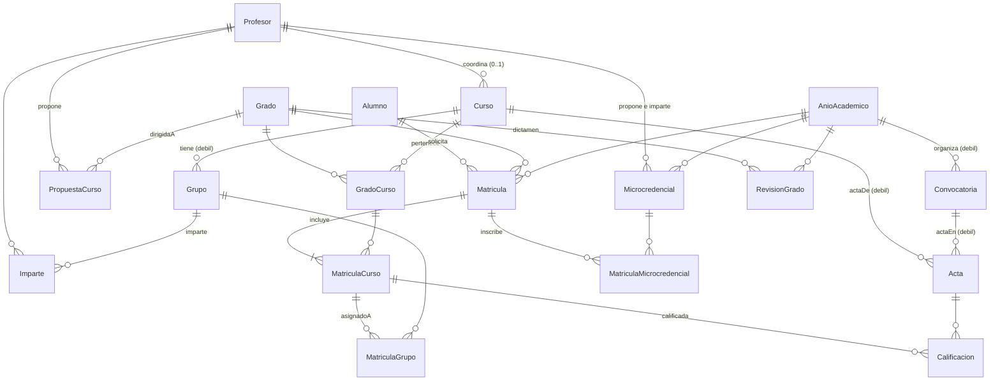
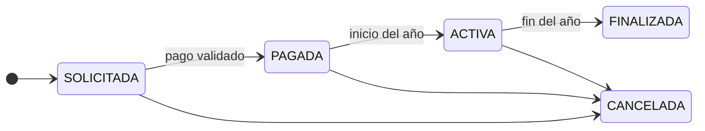
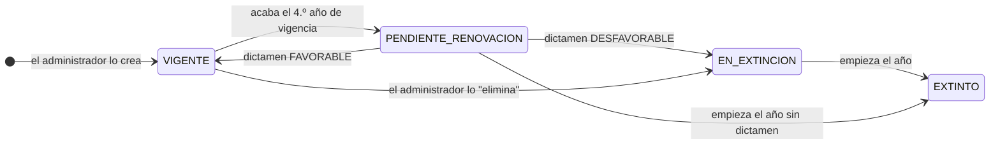
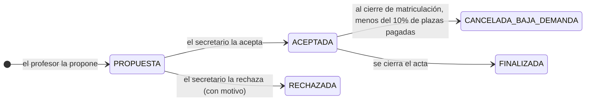
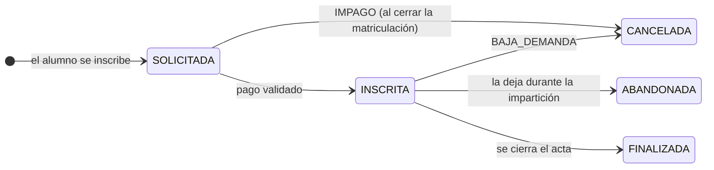

# Base de datos IPS — Cómo funciona

Documentación del modelo de datos tal y como está en `schema.sql` y `data.sql` (versión del 29 de octubre de 2026). Recoge las decisiones tomadas con el PO durante el refinamiento del sprint 1 y del sprint 2 (microcredenciales y revisión de grados).

## Índice

1. [Visión general](#1-visión-general)
2. [Diagrama](#2-diagrama)
3. [Convenciones](#3-convenciones)
4. [Tablas](#4-tablas)
5. [Ciclos de vida y estados](#5-ciclos-de-vida-y-estados)
6. [Reglas de negocio](#6-reglas-de-negocio)
7. [Qué garantiza la base de datos y qué el modelo](#7-qué-garantiza-la-base-de-datos-y-qué-el-modelo)
8. [Consultas de referencia por historia de usuario](#8-consultas-de-referencia-por-historia-de-usuario)
9. [Datos de prueba](#9-datos-de-prueba)
10. [Cómo se ejecuta](#10-cómo-se-ejecuta)
11. [Limitaciones conocidas y trabajo futuro](#11-limitaciones-conocidas-y-trabajo-futuro)

---

## 1. Visión general

La base de datos gestiona la oferta académica de una universidad y la vida académica de sus alumnos. Tiene 18 tablas, que se agrupan en cinco bloques:

| Bloque | Tablas | Qué representa |
|---|---|---|
| **Personas** | Alumno, Profesor | Quién usa el sistema. Administrador, Secretario y Revisor externo no tienen tabla: son roles que se eligen al lanzar la aplicación. |
| **Oferta académica** | AnioAcademico, Grado, Curso, GradoCurso, PropuestaCurso | Qué se oferta, cuándo y en qué grados. |
| **Docencia y evaluación** | Grupo, Imparte, Convocatoria, Acta | Cómo se organiza la docencia y dónde se ponen las notas. |
| **Matriculación** | Matricula, MatriculaCurso, MatriculaGrupo, Calificacion | En qué se matricula cada alumno, qué ha pagado, a qué grupos va y qué notas tiene. |
| **Sprint 2** | Microcredencial, MatriculaMicrocredencial, RevisionGrado | Las microcredenciales que proponen los profesores y en las que se inscriben los alumnos, y los dictámenes del revisor externo sobre la renovación de los grados. |

**Vocabulario**

- **Curso** significa siempre **asignatura**. El año del grado (1º, 2º…) es el campo `GradoCurso.anio`.
- **Matrícula** es el conjunto de asignaturas de un alumno en un grado durante un año académico. Es "el todo".
- **Matrícula en una asignatura** (MatriculaCurso) es cada una de las partes de ese todo. Tiene su propio estado y su propio pago.
- **Doble grado** es un Grado más, con sus propias asignaturas asociadas, que puede compartir con otros grados.
- **Microcredencial** es una formación corta de una rama de conocimiento, propuesta por un profesor para un año académico. Tiene plazas, un periodo de matriculación de 2 semanas, unas fechas de impartición y su propia acta. No se renueva: cada año el profesor hace una propuesta nueva.
- **Dictamen** es la valoración FAVORABLE o DESFAVORABLE que da el revisor externo a un grado pendiente de renovación. Con él, el sistema vuelve a poner el grado en vigor o lo extingue.

---

## 2. Diagrama



**Elementos del modelo entidad-relación**

| Elemento | Tipo | Cómo se implementa |
|---|---|---|
| Grupo | Entidad débil de Curso | Clave `(cursoId, grupoCodigo)`. `grupoCodigo` es el discriminante. |
| Convocatoria | Entidad débil de AnioAcademico | Clave `(anioAcademicoId, tipoConvocatoria)`. `tipoConvocatoria` es el discriminante. |
| Acta | Entidad débil con dos propietarias (Curso y Convocatoria) | Clave `(cursoId, anioAcademicoId, tipoConvocatoria)`. No tiene discriminante. |
| [Matricula – incluye – Curso] | Agregación | Tabla MatriculaCurso. Participa a su vez en *asignadoA* (con Grupo) y *calificada* (con Acta). |
| GradoCurso | Relación N:M con atributos | Una asignatura puede estar en varios grados, con distinto año, itinerario y estado en cada uno. |
| Imparte | Relación N:M | Profesor – Grupo. |
| coordina | Relación 1:N | Columna `Curso.coordinadorId`. |
| MatriculaMicrocredencial | Relación N:M con atributos | Matricula – Microcredencial, del mismo año académico. |
| RevisionGrado | Relación N:M con atributos | Grado – AnioAcademico: un dictamen por grado y año. |

---

## 3. Convenciones

- **Motor:** SQLite.
- **Nombres:** tablas en PascalCase y columnas en camelCase, sin subrayados. Es el convenio de Java que exige DbUtils para mapear columnas a los atributos de los DTO.
- **Restricciones:** todas tienen nombre, con prefijo `pk_`, `fk_`, `uq_` o `ck_`. Estos nombres sí llevan subrayado porque no se mapean a Java.
- **Claves primarias:** son texto con prefijo legible (`AL0001`, `G001`, `M00001`, `PR001`…). En entidades débiles y relaciones, la clave es compuesta.
- **Fechas:** texto en formato ISO, `'AAAA-MM-DD'`. Se comparan correctamente como texto.
- **Booleanos:** `INT` con valor 0 o 1, controlado con `CHECK`.
- **Valores enumerados** (estados, tipos, motivos): texto en MAYÚSCULAS, controlado con `CHECK ... IN (...)`.
- **Datos sin acentos**, para evitar problemas de codificación al leer los scripts desde Java en Windows.
- **Claves foráneas:** SQLite solo las comprueba si cada conexión ejecuta `PRAGMA foreign_keys = ON`. Sin esa instrucción, las restricciones `fk_` no se aplican.

---

## 4. Tablas

En cada tabla, **PK** indica clave primaria, **FK** clave foránea y **Nulo** si la columna admite valores nulos.

### 4.1 Personas

#### Alumno

| Columna | Tipo | Nulo | Descripción |
|---|---|---|---|
| alumnoId | VARCHAR(10) | no | **PK**. Por ejemplo, `AL0001`. |
| dni | VARCHAR(9) | no | Único. |
| nombre | VARCHAR(50) | no | |
| apellidos | VARCHAR(100) | no | |
| email | VARCHAR(100) | no | Único. |

#### Profesor

Misma estructura que Alumno, con clave `profesorId` (por ejemplo, `P001`).

Un profesor puede tener dos roles respecto a una asignatura, y **ninguno se guarda como columna**: es **COORDINADOR** si es el `coordinadorId` de la asignatura, y **DOCENTE** si imparte algún grupo sin ser coordinador.

### 4.2 Oferta académica

#### AnioAcademico

Lo configura el administrador (HU 35220).

| Columna | Tipo | Nulo | Descripción |
|---|---|---|---|
| anioAcademicoId | VARCHAR(10) | no | **PK**. Por ejemplo, `2026-2027`. Al ordenarse como texto, también queda en orden cronológico. |
| fechaInicio | DATE | no | Inicio del año académico. |
| fechaFin | DATE | no | Fin del año académico. Tiene que ser posterior a `fechaInicio`. |
| inicioMatriculacion | DATE | sí | Inicio del periodo de matriculación. |
| finMatriculacion | DATE | sí | Fin del periodo de matriculación. No puede ser anterior al inicio. |

#### Grado

| Columna | Tipo | Nulo | Descripción |
|---|---|---|---|
| gradoId | VARCHAR(10) | no | **PK**. |
| nombre | VARCHAR(150) | no | |
| facultad | VARCHAR(150) | no | Filtro de la HU 35220. |
| ramaConocimiento | VARCHAR(100) | no | Filtro de las HU 35220 y 36411. Una de las cinco ramas oficiales: `Artes y Humanidades`, `Ciencias`, `Ciencias de la Salud`, `Ciencias Sociales y Juridicas` o `Ingenieria y Arquitectura`. Las microcredenciales se comparan con ella. |
| estado | VARCHAR(25) | no | `VIGENTE`, `EN_EXTINCION`, `EXTINTO` o `PENDIENTE_RENOVACION`. |
| fechaInicioVigencia | DATE | no | Inicio del primero de sus 4 años académicos de vigencia (al renovarlo, el inicio del año siguiente al dictamen). La fecha de fin **no se guarda**. |

#### Curso (asignatura)

Solo guarda lo que es propio de la asignatura, sea cual sea el grado.

| Columna | Tipo | Nulo | Descripción |
|---|---|---|---|
| cursoId | VARCHAR(10) | no | **PK**. |
| coordinadorId | VARCHAR(10) | sí | **FK** → Profesor. Es nulo si todavía no tiene coordinador. |
| nombre | VARCHAR(150) | no | |
| creditos | DECIMAL(4,1) | no | Mayor que 0. Admite medios créditos, como 4.5. |

#### GradoCurso

La relación *pertenece*, de tipo N:M: una asignatura puede formar parte de varios grados. Es el caso de los dobles grados y de asignaturas comunes como Fundamentos de Informática.

| Columna | Tipo | Nulo | Descripción |
|---|---|---|---|
| gradoId | VARCHAR(10) | no | **PK**, **FK** → Grado. |
| cursoId | VARCHAR(10) | no | **PK**, **FK** → Curso. |
| anio | INT | no | Año del grado en el que se imparte (1 a 6). |
| itinerario | VARCHAR(100) | sí | Nulo si es una asignatura común. |
| estado | VARCHAR(10) | no | `ACTIVO` o `INACTIVO`. |

**Por qué el estado está aquí y no en Curso:** si una asignatura está en dos grados y uno de ellos se extingue, tiene que quedar inactiva **solo en ese grado**. En los datos de prueba, Cálculo (C001) está INACTIVO en Matemáticas (G003, extinto) y ACTIVO en Software (G001) y en el doble grado (G008).

El estado se sobrescribe cada año y **no se guarda historial**.

Una asignatura sin ninguna fila en GradoCurso existe, pero no está asociada a ningún grado todavía (C207 y C208 en los datos de prueba).

#### PropuestaCurso

La crea un profesor (HU 35243). De momento solo se registra: revisarla y convertirla en asignatura queda para un sprint futuro.

| Columna | Tipo | Nulo | Descripción |
|---|---|---|---|
| propuestaId | VARCHAR(10) | no | **PK**. |
| profesorId | VARCHAR(10) | no | **FK** → Profesor. |
| gradoId | VARCHAR(10) | no | **FK** → Grado. Es el grado al que se dirige la propuesta. |
| nombre | VARCHAR(150) | no | |
| anio | INT | no | Año del grado propuesto (1 a 6). |
| creditos | DECIMAL(4,1) | no | Mayor que 0. |
| descripcion | VARCHAR(1000) | sí | |
| fechaPropuesta | DATE | no | |
| estado | VARCHAR(10) | no | `PENDIENTE`, `ACEPTADA` o `RECHAZADA`. |

### 4.3 Docencia y evaluación

#### Grupo (entidad débil de Curso)

El grupo es de la **asignatura**, no del grado: alumnos de distintos grados comparten grupo.

| Columna | Tipo | Nulo | Descripción |
|---|---|---|---|
| cursoId | VARCHAR(10) | no | **PK**, **FK** → Curso. |
| grupoCodigo | VARCHAR(10) | no | **PK**, discriminante. Por ejemplo, `PL1`. Solo es único dentro de su asignatura. |
| tipo | VARCHAR(3) | no | `TE` (teoría), `PA` (prácticas de aula) o `PL` (prácticas de laboratorio). |
| capacidad | INT | no | Número máximo de alumnos. Mayor que 0. |

Además de la clave primaria, la tabla tiene un `UNIQUE (cursoId, grupoCodigo, tipo)`. Es redundante, pero hace falta para que MatriculaGrupo pueda apuntar también al tipo con una clave foránea.

#### Imparte (Profesor ↔ Grupo)

| Columna | Tipo | Nulo | Descripción |
|---|---|---|---|
| profesorId | VARCHAR(10) | no | **PK**, **FK** → Profesor. |
| cursoId | VARCHAR(10) | no | **PK**, parte de la **FK** → Grupo. |
| grupoCodigo | VARCHAR(10) | no | **PK**, parte de la **FK** → Grupo. |

#### Convocatoria (entidad débil de AnioAcademico)

| Columna | Tipo | Nulo | Descripción |
|---|---|---|---|
| anioAcademicoId | VARCHAR(10) | no | **PK**, **FK** → AnioAcademico. |
| tipoConvocatoria | VARCHAR(30) | no | **PK**, discriminante. Puede ser `ORDINARIA_ENERO`, `ORDINARIA_JUNIO` o `EXTRAORDINARIA_JULIO`. |
| fechaInicio | DATE | no | |
| fechaFin | DATE | no | No puede ser anterior al inicio. Si al llegar esta fecha el acta sigue abierta, el sistema la cierra automáticamente. |

#### Acta (entidad débil de Curso y Convocatoria)

Es "esta asignatura en esta convocatoria". Hay como mucho un acta por asignatura y convocatoria.

| Columna | Tipo | Nulo | Descripción |
|---|---|---|---|
| cursoId | VARCHAR(10) | no | **PK**, **FK** → Curso. |
| anioAcademicoId | VARCHAR(10) | no | **PK**, parte de la **FK** → Convocatoria. |
| tipoConvocatoria | VARCHAR(30) | no | **PK**, parte de la **FK** → Convocatoria. |
| estado | VARCHAR(7) | no | `ABIERTA` o `CERRADA`. |
| fechaCierre | DATE | sí | Obligatoria si el acta está CERRADA y nula si está ABIERTA. |
| cierreAutomatico | INT | no | 0 si la cerró el coordinador, 1 si la cerró el sistema. Las actas con 1 son la "notificación a secretaría" de la HU 35239. |

### 4.4 Matriculación

#### Matricula (el todo)

Representa a un alumno en un grado durante un año académico. Es lo que cuenta como "año en el grado" para el régimen de permanencia.

| Columna | Tipo | Nulo | Descripción |
|---|---|---|---|
| matriculaId | VARCHAR(10) | no | **PK**. |
| alumnoId | VARCHAR(10) | no | **FK** → Alumno. |
| gradoId | VARCHAR(10) | no | **FK** → Grado. |
| anioAcademicoId | VARCHAR(10) | no | **FK** → AnioAcademico. |
| fechaSolicitud | DATE | no | |
| estado | VARCHAR(10) | no | `SOLICITADA`, `ACTIVA`, `FINALIZADA` o `CANCELADA`. No existe `PAGADA` a este nivel, porque el pago es de cada asignatura. |
| motivoCancelacion | VARCHAR(20) | sí | `IMPAGO`, `FUERZA_MAYOR`, `INCOMPATIBILIDAD` o `EXTINCION_GRADO` (la pone el sistema cuando el grado se extingue al iniciar el año). Obligatorio si y solo si la matrícula está CANCELADA. |
| fechaCancelacion | DATE | sí | Obligatoria si y solo si la matrícula está CANCELADA. |

Restricciones especiales:
- `UNIQUE (alumnoId, gradoId, anioAcademicoId)`: impide solicitudes duplicadas (HU 35235).
- `UNIQUE (matriculaId, gradoId)`: es redundante, pero sirve de destino para la clave foránea de MatriculaCurso.
- `UNIQUE (matriculaId, anioAcademicoId)`: igual, para la clave foránea de MatriculaMicrocredencial.

#### MatriculaCurso (agregación [Matricula – incluye – Curso])

Cada asignatura de una matrícula, con su propio ciclo de vida y su propio pago. **Nunca se borra**: una baja se registra como cancelación.

| Columna | Tipo | Nulo | Descripción |
|---|---|---|---|
| matriculaId | VARCHAR(10) | no | **PK**, parte de la **FK** → Matricula. |
| gradoId | VARCHAR(10) | no | Copia del grado de la matrícula. Forma parte de dos claves foráneas (ver más abajo). |
| cursoId | VARCHAR(10) | no | **PK**, parte de la **FK** → GradoCurso. |
| estado | VARCHAR(10) | no | `SOLICITADA`, `PAGADA`, `ACTIVA`, `FINALIZADA` o `CANCELADA`. |
| motivoCancelacion | VARCHAR(20) | sí | Mismos valores y regla que en Matricula. |
| fechaCancelacion | DATE | sí | Misma regla que en Matricula. |
| importe | DECIMAL(10,2) | no | Créditos × precio por crédito, calculado al solicitar. Se guarda para que un cambio de precio futuro no altere lo ya cobrado. |
| metodoPago | VARCHAR(15) | sí | `TARJETA`, `TRANSFERENCIA` o `CARTA_PAGO`. Es nulo mientras el alumno no ha pagado. |
| fechaPago | DATE | sí | |
| pagoValidado | INT | no | 1 si el pago está aceptado. Con tarjeta es automático; con transferencia o carta de pago lo valida el secretario. |

**El truco del `gradoId` repetido:** la tabla tiene dos claves foráneas que comparten esa columna:
- `(matriculaId, gradoId)` → Matricula: el `gradoId` tiene que ser el de la matrícula.
- `(gradoId, cursoId)` → GradoCurso: la asignatura tiene que pertenecer a ese grado.

Juntas garantizan, **desde la propia base de datos**, que nadie se matricule en una asignatura que no es de su grado.

**Regla de pago (`ck_matriculaCurso_pagada`):** una asignatura PAGADA, ACTIVA o FINALIZADA tiene que tener método de pago, fecha de pago y `pagoValidado = 1`. Una asignatura CANCELADA puede tener pago o no, porque no se devuelve el dinero.

#### MatriculaGrupo (relación *asignadoA* de la agregación)

Los grupos de cada alumno en cada asignatura. Los asigna el secretario.

| Columna | Tipo | Nulo | Descripción |
|---|---|---|---|
| matriculaId | VARCHAR(10) | no | **PK**, parte de la **FK** → MatriculaCurso. |
| cursoId | VARCHAR(10) | no | **PK**, compartido por las dos claves foráneas. |
| tipo | VARCHAR(3) | no | **PK**, parte de la **FK** → Grupo. |
| grupoCodigo | VARCHAR(10) | no | Parte de la **FK** → Grupo. |

Lo que garantiza la propia base de datos:
- La clave primaria `(matriculaId, cursoId, tipo)` impide tener **dos grupos del mismo tipo** en la misma asignatura.
- La clave foránea `(cursoId, grupoCodigo, tipo)` → Grupo obliga a que el grupo sea **de esa asignatura** y **del tipo indicado**.

#### Calificacion (relación *calificada* de la agregación)

Una nota por cada asignatura matriculada y cada convocatoria.

| Columna | Tipo | Nulo | Descripción |
|---|---|---|---|
| matriculaId | VARCHAR(10) | no | **PK**, parte de la **FK** → MatriculaCurso. |
| cursoId | VARCHAR(10) | no | **PK**, compartido por las dos claves foráneas. |
| anioAcademicoId | VARCHAR(10) | no | **PK**, parte de la **FK** → Acta. |
| tipoConvocatoria | VARCHAR(30) | no | **PK**, parte de la **FK** → Acta. |
| nota | DECIMAL(4,2) | sí | Entre 0 y 10. Un valor **nulo significa no presentado**. |

Como `cursoId` es compartido, el acta tiene que ser de la misma asignatura que la matrícula.

Al cerrar un acta, los alumnos que entran en ella y no tienen nota reciben una calificación con `nota` nula (NP), que no consume convocatoria (ver 5.4).

### 4.5 Microcredenciales (sprint 2)

Historias: 35988 (el profesor propone), 35994 (el secretario acepta o rechaza), 35987 (el alumno se inscribe y paga), 36410 (cancelación automática por baja demanda) y 36459 (el profesor califica y cierra el acta).

#### Microcredencial

Una fila por propuesta. Las propuestas y las microcredenciales aceptadas están en la misma tabla: "se registra oficialmente como microcredencial" (HU 35994) es pasar de PROPUESTA a ACEPTADA. No hay renovación: si el profesor quiere volver a ofertarla otro año, hace una propuesta nueva.

| Columna | Tipo | Nulo | Descripción |
|---|---|---|---|
| microcredencialId | VARCHAR(10) | no | **PK**. `MC` seguido de un número (`MC053` después de `MC052`). |
| anioAcademicoId | VARCHAR(10) | no | **FK** → AnioAcademico. |
| profesorId | VARCHAR(10) | no | **FK** → Profesor. Quien la propone, la imparte y es el único que califica y cierra su acta. |
| nombre | VARCHAR(150) | no | Único por año. |
| ramaConocimiento | VARCHAR(100) | no | Una de las cinco ramas oficiales. |
| creditos | DECIMAL(4,1) | no | Mayor que 0 y como máximo `MAX_CREDITOS_MICROCREDENCIAL` (se valida en el modelo). |
| plazas | INT | no | Las fija el profesor. Mayor que 0. |
| inicioMatriculacion | DATE | no | |
| finMatriculacion | DATE | no | Inicio + 14 días (se valida en el modelo). |
| inicioImparticion | DATE | no | Tiempo de ejecución. Posterior al fin de la matriculación. |
| finImparticion | DATE | no | Posterior al inicio de la impartición. |
| estado | VARCHAR(25) | no | `PROPUESTA`, `ACEPTADA`, `RECHAZADA`, `CANCELADA_BAJA_DEMANDA` o `FINALIZADA`. |
| fechaPropuesta | DATE | no | |
| fechaResolucion | DATE | sí | Cuándo la aceptó o rechazó el secretario. Nula si y solo si está PROPUESTA. No se guarda qué secretario fue. |
| motivoRechazo | VARCHAR(500) | sí | Obligatorio si y solo si está RECHAZADA. |
| fechaCancelacion | DATE | sí | Obligatoria si y solo si está CANCELADA_BAJA_DEMANDA. Es el día antes de la impartición. |
| fechaCierreActa | DATE | sí | El acta está abierta mientras sea nula. Obligatoria si y solo si está FINALIZADA. |
| cierreAutomatico | INT | no | 0 si la cerró el profesor (o sigue abierta), 1 si la cerró el sistema por pasar el plazo. |

#### MatriculaMicrocredencial (Matricula ↔ Microcredencial)

La inscripción de un alumno, con su pago y su nota. **Nunca se borra.**

| Columna | Tipo | Nulo | Descripción |
|---|---|---|---|
| matriculaId | VARCHAR(10) | no | **PK**, parte de la **FK** → Matricula. |
| anioAcademicoId | VARCHAR(10) | no | Compartido por las dos claves foráneas. |
| microcredencialId | VARCHAR(10) | no | **PK**, parte de la **FK** → Microcredencial. |
| fechaSolicitud | DATE | no | Dentro del periodo de matriculación. |
| estado | VARCHAR(10) | no | `SOLICITADA`, `INSCRITA`, `FINALIZADA`, `ABANDONADA` o `CANCELADA`. |
| motivoCancelacion | VARCHAR(15) | sí | `IMPAGO` o `BAJA_DEMANDA`. Obligatorio si y solo si está CANCELADA. |
| fechaBaja | DATE | sí | Obligatoria si y solo si está ABANDONADA o CANCELADA. |
| importe | DECIMAL(10,2) | no | Créditos de la microcredencial × precio por crédito. |
| metodoPago | VARCHAR(15) | sí | `TARJETA`, `TRANSFERENCIA` o `CARTA_PAGO`. Nulo mientras no ha pagado. |
| fechaPago | DATE | sí | |
| pagoValidado | INT | no | 1 si el pago está aceptado: automático con tarjeta; con transferencia o carta de pago lo valida el secretario. |
| nota | DECIMAL(4,2) | sí | Entre 0 y 10. La pone el profesor con el acta abierta (INSCRITA) y queda fija al cerrarla (FINALIZADA). Nula en una FINALIZADA = no presentado. |

Decisiones de diseño:
- **Cuelga de la Matricula del alumno de ese año.** La inscripción se hace desde la ventana de nueva matrícula (HU 35987) y la matrícula indica el grado y, con él, la rama. Que la rama coincida lo comprueba el modelo.
- **El `anioAcademicoId` repetido** forma parte de las dos claves foráneas, así que la base de datos garantiza que la microcredencial es del mismo año que la matrícula. Es el mismo truco que `gradoId` en MatriculaCurso.
- **Sus créditos no cuentan para la permanencia ni para los hitos** (HU 35987), porque no están en MatriculaCurso ni en Calificacion, que es de donde salen los créditos superados.
- **Regla de pago (`ck_matriculaMicrocredencial_pagada`):** INSCRITA, FINALIZADA y ABANDONADA exigen el pago validado. Una cancelación por IMPAGO no tiene el pago validado y una por BAJA_DEMANDA sí lo tiene (`ck_matriculaMicrocredencial_pagoCancelacion`). El dinero no se devuelve nunca, porque es una simulación.

### 4.6 Revisión de grados (sprint 2)

#### RevisionGrado

El dictamen del revisor externo sobre un grado pendiente de renovación (HU 36455). No hay informes ni se guarda qué revisor lo emite: el revisor externo es un rol de la aplicación, como el secretario.

| Columna | Tipo | Nulo | Descripción |
|---|---|---|---|
| gradoId | VARCHAR(10) | no | **PK**, **FK** → Grado. |
| anioAcademicoId | VARCHAR(10) | no | **PK**, **FK** → AnioAcademico. El año que va a empezar: si es FAVORABLE, el primero de la nueva vigencia. Tiene que existir (lo crea el administrador, HU 35220). |
| resultado | VARCHAR(12) | no | `FAVORABLE` o `DESFAVORABLE`. |
| fechaRevision | DATE | no | Siempre entre el fin del año anterior y el inicio de este (se valida en el modelo). |

La clave primaria impide dar dos dictámenes al mismo grado para el mismo año. Se guarda el historial de todas las renovaciones.

---

## 5. Ciclos de vida y estados

### 5.1 Matrícula y sus asignaturas

El estado existe en los dos niveles. **Siempre se cambian juntos**, en el mismo método del modelo:

| Evento | Matricula | MatriculaCurso |
|---|---|---|
| El alumno solicita | SOLICITADA | SOLICITADA (todas) |
| El alumno paga con tarjeta | sin cambios | esa asignatura pasa a PAGADA (`pagoValidado = 1`) |
| El alumno paga por transferencia o carta de pago | sin cambios | sigue SOLICITADA, con método y fecha rellenos y `pagoValidado = 0` |
| El secretario valida el pago | sin cambios | pasa a PAGADA (`pagoValidado = 1`) |
| Empieza el año académico | pasa a ACTIVA si tiene al menos una asignatura PAGADA | las PAGADAS pasan a ACTIVA; las SOLICITADAS quedan pendientes de que las revise el secretario |
| Se cancela una asignatura | sin cambios | esa pasa a CANCELADA, con motivo y fecha |
| Se cancela la última asignatura no cancelada | pasa a CANCELADA, con el motivo y la fecha de esa asignatura | esa pasa a CANCELADA |
| Se cancela la matrícula entera | CANCELADA | todas las no finalizadas pasan a CANCELADA, con el mismo motivo y fecha |
| Termina el año | FINALIZADA | las ACTIVAS pasan a FINALIZADA |
| Empieza el año y su grado se extingue (5.2) | CANCELADA (`EXTINCION_GRADO`, fecha de inicio del año) | todas pasan a CANCELADA con el mismo motivo y fecha |


*Estados de MatriculaCurso. Matricula sigue el mismo esquema, pero sin PAGADA.*

Además:
- **Se puede cancelar en cualquier momento** antes de FINALIZADA, y **no se devuelve el dinero**.
- **Nada se borra:** las matrículas y asignaturas canceladas se conservan, junto con sus notas.
- **Plazo de pago:** de momento no existe. Las asignaturas sin pagar se quedan SOLICITADAS hasta que el secretario decide.

### 5.2 Grado



- **Pasa a PENDIENTE_RENOVACION** al terminar el año académico que completa sus 4 años de vigencia. Lo hace el sistema al cerrar el año. *(Supuesto: las historias no dicen quién lo pone pendiente.)*
- **Ventana de valoración (HU 36455):** el revisor externo solo puede emitir el dictamen entre el fin de ese año (`AnioAcademico.fechaFin`) y el inicio del siguiente (`fechaInicio`), viendo antes las métricas del grado (HU 36411) y confirmando la decisión. El dictamen queda en RevisionGrado.
- **FAVORABLE:** el sistema pone el grado VIGENTE en ese momento, con `fechaInicioVigencia` = inicio del año que va a empezar. Tiene otros 4 años de vigencia.
- **DESFAVORABLE:** el sistema lo pone EN_EXTINCION en ese momento. Ya no se admiten solicitudes de matrícula en él.
- **"Eliminar" un grado (HU 35223)** no lo borra: lo pasa también a EN_EXTINCION.
- **Al iniciar el año**, el sistema pone EXTINTO todo grado EN_EXTINCION o PENDIENTE_RENOVACION (sin dictamen) y **cancela sus matrículas de ese año**, con todas sus asignaturas, con motivo `EXTINCION_GRADO`. En ese mismo proceso se desactivan sus asignaturas (5.3). Así, EN_EXTINCION solo dura desde el dictamen o el borrado hasta el inicio del año siguiente.

### 5.3 Asignatura en un grado (GradoCurso)

`ACTIVO` ↔ `INACTIVO`

- "Eliminar" una asignatura la pasa a INACTIVO.
- **Desactivación automática al iniciar el año:** se desactiva si su grado está EN_EXTINCION o EXTINTO, o si no tiene matrículas ese año. Ver la consulta en el [apartado 8](#hu-35223--desactivación-automática-al-iniciar-el-año).
- Puede volver a activarse a mano, sin historial.

### 5.4 Acta

`ABIERTA` → `CERRADA`

- **Cierre manual:** lo hace el coordinador desde la vista del profesor, con confirmación (`cierreAutomatico = 0`).
- **Cierre automático:** lo hace el sistema al arrancar la aplicación (`MainController`) y al recargar la base de datos, con todas las actas ABIERTAS cuya convocatoria ya terminó (`Convocatoria.fechaFin` anterior a hoy). Quedan con `cierreAutomatico = 1`, y cada una es un aviso para secretaría.
- **En los dos cierres**, los alumnos del acta que no tienen nota quedan como no presentados (NP), en la misma transacción. Así el acta cerrada no pierde alumnos.
- Mientras está CERRADA no se pueden añadir ni modificar notas.
- **Quién entra en un acta:** los matriculados en la asignatura ese año (PAGADA, ACTIVA o FINALIZADA) que no la han aprobado ya en una convocatoria anterior del mismo año. Por ejemplo, quien aprueba en enero no aparece en junio ni en julio. En un acta cerrada solo salen los que tienen calificación.

### 5.5 Propuesta de curso

`PENDIENTE` → `ACEPTADA` o `RECHAZADA`.

- El profesor crea las propuestas como `PENDIENTE`, con la fecha actual (HU 35243).
- Aceptarlas o rechazarlas queda para un sprint futuro (ver 11).
- El nombre de una propuesta `RECHAZADA` se puede volver a proponer en el mismo grado.

### 5.6 Microcredencial



- **PROPUESTA (HU 35988):** el profesor indica nombre, rama, plazas, créditos (sin superar el máximo), el periodo de matriculación de 2 semanas y las fechas de impartición. Si todo es válido, se guarda como PROPUESTA.
- **Revisión (HU 35994):** el secretario ve las pendientes con nombre, profesor, créditos y periodo de impartición. Si la acepta, pasa a ACEPTADA y queda en la oferta. Si la rechaza, el motivo es obligatorio, pasa a RECHAZADA y no se reutiliza: el profesor tendría que crear otra propuesta desde cero.
- **Al concluir la matriculación (HU 36410):** se evalúa el día antes de que cierre el periodo de matriculación. Un proceso por lotes cancela por IMPAGO las inscripciones que siguen SOLICITADAS. Después cuenta las pagadas: si `pagadas × 10 < plazas`, pasa la microcredencial a CANCELADA_BAJA_DEMANDA y sus inscripciones a CANCELADA (BAJA_DEMANDA), con fecha de ese día. El profesor y los alumnos lo ven en sus vistas; no hay otro aviso.
- **Sin renovaciones:** a diferencia de los grados (HU 36455), las microcredenciales no se renuevan; si se quiere volver a ofertar al curso siguiente, debe generarse una nueva propuesta desde cero (HU 35988).
- **Cierre del acta (HU 36459):** al cerrarla, la microcredencial pasa a FINALIZADA (ver 5.8).

### 5.7 Inscripción en una microcredencial



- Con **tarjeta**, el pago se valida en el momento. Con **transferencia o carta de pago**, queda SOLICITADA con método y fecha hasta que el secretario lo valida.
- **Las plazas y el 10 % cuentan solo las inscripciones con el pago validado.**
- No se devuelve el dinero en ningún caso.

### 5.8 Acta de una microcredencial (HU 36459)

`abierta` (`fechaCierreActa` nula) → `cerrada`

- Solo el profesor de la microcredencial ve su acta, pone notas y la cierra. En el acta salen solo las inscripciones con el pago validado (INSCRITA o FINALIZADA); las abandonadas y canceladas no aparecen.
- Puede poner y cambiar notas desde que empieza la impartición hasta que cierra el acta. Una inscripción sin nota al cerrar queda como no presentado.
- **Cierre manual:** con confirmación. Las inscripciones INSCRITAS pasan a FINALIZADA, la microcredencial a FINALIZADA y se guarda la fecha (`cierreAutomatico = 0`).
- **Cierre automático:** si el profesor no la cierra en los 15 días siguientes al fin de la impartición, la cierra el sistema con las notas que haya, con fecha de fin de impartición + 15 días (`cierreAutomatico = 1`).
- **Una única convocatoria:** no hay extraordinaria. *(Supuesto, pendiente de confirmar con el PO, igual que los 15 días.)*
- El alumno solo ve su nota en "Mis matriculaciones" cuando el acta está cerrada.

---

## 6. Reglas de negocio

### 6.1 Constantes (en el código, no en la base de datos)

| Constante | Valor | Uso |
|---|---|---|
| `PRECIO_CREDITO` | 20 € | `importe = creditos × 20`. Es igual en todos los grados y no cambia por repetir asignatura. |
| `CREDITOS_MINIMOS_ANIO` | 12 | Créditos superados exigidos cada año. |
| `CREDITOS_MINIMOS_TERCER_ANIO` | 90 | Créditos superados exigidos al acabar el tercer año en el grado. |
| `MAX_CONVOCATORIAS` | 6 | Convocatorias con nota permitidas por asignatura. |
| `NOTA_APROBADO` | 5 | Nota mínima para superar una asignatura (y una microcredencial). |
| `MAX_CREDITOS_MICROCREDENCIAL` | 15 | **Provisional**: la HU 35988 habla de un "máximo estipulado" sin valor. Cuando el PO lo dé, solo se cambia aquí. |
| `DIAS_MATRICULACION_MICROCREDENCIAL` | 14 | Periodo de matriculación de 2 semanas. |
| `PORCENTAJE_MINIMO_PLAZAS_MICROCREDENCIAL` | 10 | De plazas pagadas, el día antes de la impartición. |
| `DIAS_CIERRE_ACTA_MICROCREDENCIAL` | 15 | Plazo para cerrar el acta tras el fin de la impartición. |
| `ANIOS_VIGENCIA_GRADO` | 4 | Años académicos de vigencia de un grado nuevo o renovado. |

### 6.2 Créditos superados

Una asignatura está superada cuando tiene alguna calificación con `nota >= 5`. Sus créditos se suman **una sola vez**, aunque tenga varias notas aprobadas.

### 6.3 Régimen de permanencia (HU 35235)

Al solicitar matrícula en un grado se comprueba:

1. **Mínimo anual:** si la matrícula del año anterior en ese grado **no** está CANCELADA, el alumno tuvo que superar al menos 12 créditos ese año.
2. **Mínimo al tercer año:** si ya lleva 3 o más años en el grado, tiene que sumar al menos 90 créditos superados en total. Los años con la matrícula cancelada **sí cuentan** como años.
3. **Límite de convocatorias:** en cada asignatura solicitada, el alumno tiene que tener menos de 6 convocatorias con nota. Las notas nulas (no presentado) no cuentan. Se suman las de **todos sus años y todos sus grados**.

Si falla la 1 o la 2, se rechaza la matrícula en ese grado, aunque el alumno puede matricularse en otro. Si falla la 3, solo se rechaza esa asignatura.

### 6.4 Al corriente de pago (HU 35235)

**Interpretación actual, pendiente de confirmar con el PO:** el alumno está al corriente si no tiene asignaturas SOLICITADAS sin pagar en años ya iniciados, ni asignaturas canceladas por IMPAGO.

### 6.5 Hitos de permanencia (HU 35232)

Los hitos que ve el alumno son los dos mínimos de la permanencia:
- créditos superados este año, frente a 12;
- créditos superados en total, frente a 90.

### 6.6 Número de matrícula (HU 35232)

**No se guarda.** Para una asignatura en un año, es el número de veces que el alumno se ha matriculado en ella hasta ese año, incluido. La HU lo usa solo para ordenar; no condiciona ninguna regla.

### 6.7 Grupos y plazas

- El alumno tiene **un grupo de cada tipo que tenga la asignatura**.
- Los asigna el **secretario**, después de la matrícula y solo a asignaturas PAGADAS o ACTIVAS.
- No se puede superar `Grupo.capacidad`. Solo ocupan plaza las asignaturas PAGADAS o ACTIVAS del año en curso.

### 6.8 Actas y notas (HU 35239)

- El rol del profesor en una asignatura no se guarda: es **COORDINADOR** si es `Curso.coordinadorId` y **DOCENTE** si solo imparte algún grupo.
- Solo el coordinador pone notas y cierra el acta, y solo si está ABIERTA. El docente solo consulta.
- La nota es un número entre 0 y 10 (se admite coma o punto decimal), `NP` (calificación con nota nula) o vacía (sin calificar: se borra la calificación).
- Se validan todas las notas antes de guardar y se guardan en una única transacción: si una no es válida, no se guarda ninguna.

### 6.9 Propuestas de asignaturas (HU 35243)

- El profesor solo ve y elige los grados en los que imparte docencia (algún grupo de una asignatura del grado). Salen también los no vigentes, con su estado, para poder explicar por qué se rechazan.
- Solo se admiten grados **VIGENTES**.
- Si se eligen varios grados se crea **una propuesta por grado**, y se guardan **todas o ninguna** (una transacción).
- Datos obligatorios: nombre (como mucho 150 caracteres), año (entero de 1 a 6) y créditos (mayores que 0, menores que 1000 y con un decimal como mucho, por `DECIMAL(4,1)`). La descripción es opcional (como mucho 1000).
- El nombre **no puede repetirse en el grado**, sin distinguir mayúsculas ni espacios de los extremos, ni como asignatura del grado ni como propuesta no rechazada.
- El identificador es `PR` seguido del siguiente número (`PR031` después de `PR030`).
- La vista valida los datos **antes** de pedir confirmación, y guarda después de confirmar.

### 6.10 Microcredenciales

- **Inscripción (HU 35987):** desde la ventana de nueva matrícula, opción "Microcredenciales". El alumno solo puede inscribirse si:
  1. está habilitado en la **misma rama** que la microcredencial (por tener una matrícula no cancelada ese año en un grado de esa rama o por haber finalizado un grado de la misma con anterioridad, a modo de ampliación de estudios);
  2. la microcredencial está ACEPTADA y hoy está **dentro de su periodo de matriculación**;
  3. quedan **plazas** (contando solo las inscripciones pagadas);
  4. no está ya inscrito en ella (lo impide la clave primaria).
- **Pago:** `importe = créditos de la microcredencial × PRECIO_CREDITO`, con los mismos métodos y la misma validación del secretario que las asignaturas. El pago debe quedar completado antes del inicio de las clases. No hay devoluciones.
- **Créditos:** no cuentan para la permanencia ni para los hitos, y no existe un límite máximo de créditos ECTS que el estudiante pueda sumar en microcredenciales.
- El profesor solo califica sus propias microcredenciales.

### 6.11 Revisión de grados y métricas (HU 36411 y 36455)

Métricas por grado y año, filtrables por rama de conocimiento, curso académico y grado:

| Indicador | Cómo se calcula |
|---|---|
| **Volumen de matriculados** | Matrículas no canceladas del grado en ese año. |
| **Aprobados** | Asignaturas superadas (con alguna nota ≥ 5) en esas matrículas. |
| **Tasa de éxito** | Aprobados / asignaturas matriculadas no canceladas. |
| **Tasa de abandono** | Alumnos que no tienen matrícula no cancelada en el grado al año siguiente sin haberse graduado / matriculados. Se considera graduado a quien ha superado todas las asignaturas comunes del grado (las que no son de itinerario). No se calcula para el año en curso. |

---

## 7. Qué garantiza la base de datos y qué el modelo

### Lo garantiza la base de datos (restricciones)

| Regla | Restricción |
|---|---|
| No hay matrículas duplicadas (alumno + grado + año) | `uq_matricula_solicitud` |
| La asignatura pertenece al grado de la matrícula | `fk_matriculaCurso_matricula` y `fk_matriculaCurso_gradoCurso` |
| Un solo grupo de cada tipo por asignatura | `pk_matriculaGrupo` |
| El grupo es de esa asignatura y de ese tipo | `fk_matriculaGrupo_grupo` |
| El acta es de la misma asignatura que la matrícula | `fk_calificacion_acta` (comparte `cursoId`) |
| Una cancelación tiene siempre motivo y fecha | `ck_*_cancelacionMotivo` y `ck_*_cancelacionFecha` |
| Una asignatura pagada, activa o finalizada tiene el pago validado | `ck_matriculaCurso_pagada` |
| Un acta cerrada tiene fecha de cierre | `ck_acta_cierre` |
| Valores válidos en estados, tipos, motivos y métodos de pago | `ck_*_estado`, `ck_*_tipo`, etc. |
| Rangos numéricos (créditos > 0, nota entre 0 y 10, capacidad > 0…) | `ck_*` |
| Ramas de conocimiento válidas en grados y microcredenciales | `ck_grado_rama`, `ck_microcredencial_rama` |
| La microcredencial es del mismo año que la matrícula desde la que se inscribe | `fk_matriculaMicrocredencial_matricula` y `fk_matriculaMicrocredencial_microcredencial` (comparten `anioAcademicoId`) |
| Fechas de la microcredencial en orden (matriculación antes de la impartición) | `ck_microcredencial_matriculacion`, `ck_microcredencial_imparticion` |
| Un rechazo tiene motivo; una baja demanda, fecha; una propuesta no tiene resolución; FINALIZADA ⇔ acta cerrada | `ck_microcredencial_rechazo`, `_cancelacion`, `_resolucion`, `_acta` |
| Inscripción INSCRITA, FINALIZADA o ABANDONADA con pago validado; IMPAGO sin pago validado; BAJA_DEMANDA con pago | `ck_matriculaMicrocredencial_pagada`, `ck_matriculaMicrocredencial_pagoCancelacion` |
| La nota solo existe en inscripciones INSCRITAS o FINALIZADAS; las bajas tienen fecha y las cancelaciones motivo | `ck_matriculaMicrocredencial_nota`, `_baja`, `_cancelacion` |
| Un dictamen por grado y año, siempre FAVORABLE o DESFAVORABLE | `pk_revisionGrado`, `ck_revisionGrado_resultado` |

### Lo tiene que garantizar el modelo (validaciones en Java)

- Las transiciones de estado válidas, y que Matricula y MatriculaCurso cambien siempre juntas.
- La cancelación en cascada (matrícula → asignaturas) y la inversa (última asignatura → matrícula).
- La permanencia, el límite de convocatorias y estar al corriente de pago.
- No superar la capacidad de un grupo.
- Asignar grupos solo a asignaturas PAGADAS o ACTIVAS.
- No matricular en asignaturas INACTIVAS ni en grados EXTINTOS o EN_EXTINCION.
- Solicitar solo dentro del periodo de matriculación.
- Calificar solo en actas ABIERTAS, y que solo el coordinador suba notas y cierre el acta.
- Al cerrar un acta (a mano o automáticamente), dejar como NP a los alumnos sin nota.
- Que un profesor solo proponga asignaturas en grados donde imparte y que estén VIGENTES, sin repetir nombre en el grado, y que una propuesta en varios grados se guarde entera o no se guarde.
- Pedir confirmación antes de "eliminar" un grado o una asignatura, y no hacerlo si deja datos inconsistentes.
- No admitir solicitudes de matrícula en grados EN_EXTINCION.
- El ciclo de los grados: ponerlos PENDIENTE_RENOVACION al acabar su vigencia, aceptar dictámenes solo en la ventana entre años y solo sobre grados pendientes, aplicar su efecto y, al iniciar el año, extinguir los grados y cancelar sus matrículas (5.2).
- Microcredenciales: máximo de créditos, 14 días de matriculación, misma rama que el grado del alumno, matrícula no cancelada, dentro del periodo y con plazas pagadas libres; solo el secretario acepta o rechaza, y solo el profesor de la microcredencial califica y cierra su acta (con confirmación).
- Los procesos automáticos de las microcredenciales: el lote del día antes de la impartición y el cierre automático del acta.
- Mostrar al alumno la nota de una microcredencial solo cuando el acta está cerrada.

---

## 8. Consultas de referencia por historia de usuario

Todas estas consultas están probadas con `data.sql`. Los valores fijos (`'AL001'`, `'2026-2027'`…) son ejemplos; en el código van como parámetros `?`.

### HU 35220 — Vista general del administrador

Asignaturas con sus filtros (grado, año, itinerario, profesor y estado):

```sql
SELECT g.nombre AS grado, gc.anio, gc.itinerario, c.nombre AS curso,
       c.creditos, gc.estado, p.nombre || ' ' || p.apellidos AS coordinador
FROM GradoCurso gc
JOIN Grado g ON g.gradoId = gc.gradoId
JOIN Curso c ON c.cursoId = gc.cursoId
LEFT JOIN Profesor p ON p.profesorId = c.coordinadorId
WHERE gc.gradoId = 'G001' AND gc.estado = 'ACTIVO'
ORDER BY gc.anio, c.nombre;
```

### HU 35223 — Desactivación automática al iniciar el año

```sql
UPDATE GradoCurso
SET estado = 'INACTIVO'
WHERE gradoId IN (SELECT gradoId FROM Grado WHERE estado IN ('EN_EXTINCION', 'EXTINTO'))
   OR NOT EXISTS (SELECT 1 FROM MatriculaCurso mc
                  JOIN Matricula m ON m.matriculaId = mc.matriculaId
                  WHERE mc.gradoId = GradoCurso.gradoId
                    AND mc.cursoId = GradoCurso.cursoId
                    AND m.anioAcademicoId = '2026-2027');
```

### HU 35226 — Matrículas por grupo (secretario)

```sql
SELECT a.alumnoId, a.nombre, a.apellidos, m.gradoId, mc.estado
FROM MatriculaGrupo mg
JOIN MatriculaCurso mc ON mc.matriculaId = mg.matriculaId AND mc.cursoId = mg.cursoId
JOIN Matricula m ON m.matriculaId = mc.matriculaId
JOIN Alumno a ON a.alumnoId = m.alumnoId
WHERE mg.cursoId = 'C005' AND mg.grupoCodigo = 'TE1'
  AND m.anioAcademicoId = '2026-2027';
```

### HU 35229 — Pagos pendientes de validar (secretario)

```sql
SELECT mc.matriculaId, m.alumnoId, mc.cursoId, mc.metodoPago, mc.fechaPago, mc.importe
FROM MatriculaCurso mc
JOIN Matricula m ON m.matriculaId = mc.matriculaId
WHERE mc.estado = 'SOLICITADA'
  AND mc.metodoPago IN ('TRANSFERENCIA', 'CARTA_PAGO')
  AND mc.pagoValidado = 0;
```

### HU 35229 — Asignaturas sin pagar con el año ya iniciado

```sql
SELECT mc.matriculaId, m.alumnoId, mc.cursoId
FROM MatriculaCurso mc
JOIN Matricula m ON m.matriculaId = mc.matriculaId
JOIN AnioAcademico a ON a.anioAcademicoId = m.anioAcademicoId
WHERE mc.estado = 'SOLICITADA' AND mc.metodoPago IS NULL
  AND a.fechaInicio <= '2026-10-09';   -- fecha actual
```

### HU 35229 — Asignaturas a las que les faltan grupos

```sql
SELECT mc.matriculaId, mc.cursoId, mc.estado
FROM MatriculaCurso mc
WHERE mc.estado IN ('PAGADA', 'ACTIVA')
  AND (SELECT COUNT(*) FROM MatriculaGrupo mg
       WHERE mg.matriculaId = mc.matriculaId AND mg.cursoId = mc.cursoId)
    < (SELECT COUNT(DISTINCT tipo) FROM Grupo g WHERE g.cursoId = mc.cursoId);
```

### HU 35229 — Plazas libres por grupo

```sql
SELECT g.cursoId, g.grupoCodigo, g.tipo, g.capacidad,
       g.capacidad - (SELECT COUNT(*)
                      FROM MatriculaGrupo mg
                      JOIN MatriculaCurso mc ON mc.matriculaId = mg.matriculaId AND mc.cursoId = mg.cursoId
                      JOIN Matricula m ON m.matriculaId = mc.matriculaId
                      WHERE mg.cursoId = g.cursoId AND mg.grupoCodigo = g.grupoCodigo
                        AND mc.estado IN ('PAGADA', 'ACTIVA')
                        AND m.anioAcademicoId = '2026-2027') AS plazasLibres
FROM Grupo g
WHERE g.cursoId = 'C005';
```

### HU 35232 — Matriculaciones del alumno en el grado consultado

Al filtrar por `m.gradoId`, en un doble grado solo salen las asignaturas de ese grado. El número de matrícula se calcula en la propia consulta:

```sql
SELECT m.anioAcademicoId, c.nombre, gc.anio, mc.estado,
       (SELECT COUNT(*) FROM MatriculaCurso mc2
        JOIN Matricula m2 ON m2.matriculaId = mc2.matriculaId
        WHERE m2.alumnoId = m.alumnoId AND mc2.cursoId = mc.cursoId
          AND m2.anioAcademicoId <= m.anioAcademicoId) AS numMatricula
FROM MatriculaCurso mc
JOIN Matricula m ON m.matriculaId = mc.matriculaId
JOIN Curso c ON c.cursoId = mc.cursoId
JOIN GradoCurso gc ON gc.gradoId = mc.gradoId AND gc.cursoId = mc.cursoId
WHERE m.alumnoId = 'AL002' AND m.gradoId = 'G002'
ORDER BY gc.anio, numMatricula DESC;
```

### HU 35232 — Créditos superados por año (hitos)

```sql
SELECT m.alumnoId, m.gradoId, m.anioAcademicoId, m.estado,
       COALESCE(SUM(c.creditos), 0) AS creditosSuperados
FROM Matricula m
LEFT JOIN (SELECT DISTINCT matriculaId, cursoId FROM Calificacion WHERE nota >= 5) a
       ON a.matriculaId = m.matriculaId
LEFT JOIN Curso c ON c.cursoId = a.cursoId
WHERE m.alumnoId = 'AL001'
GROUP BY m.matriculaId
ORDER BY m.anioAcademicoId;
```

### HU 35235 — Años en el grado y créditos totales (permanencia)

```sql
SELECT COUNT(*) AS aniosEnGrado,
       COALESCE((SELECT SUM(c.creditos)
                 FROM (SELECT DISTINCT ca.cursoId
                       FROM Calificacion ca
                       JOIN Matricula m2 ON m2.matriculaId = ca.matriculaId
                       WHERE m2.alumnoId = 'AL001' AND m2.gradoId = 'G001'
                         AND ca.nota >= 5) s
                 JOIN Curso c ON c.cursoId = s.cursoId), 0) AS creditosTotales
FROM Matricula
WHERE alumnoId = 'AL001' AND gradoId = 'G001';
```

### HU 35235 — Convocatorias consumidas en una asignatura

```sql
SELECT COUNT(*) AS convocatoriasConsumidas
FROM Calificacion ca
JOIN Matricula m ON m.matriculaId = ca.matriculaId
WHERE m.alumnoId = 'AL002' AND ca.cursoId = 'C005'
  AND ca.nota IS NOT NULL;
```

### HU 35239 — Asignaciones docentes de un profesor, con su rol

Una asignatura puede estar en varios grados: se muestran todos separados por comas (`ProfesorRepository`).

```sql
SELECT i.cursoId, c.nombre AS curso, GROUP_CONCAT(gr.nombre, ', ') AS grado, i.grupoCodigo, g.tipo,
       CASE WHEN c.coordinadorId = i.profesorId THEN 'COORDINADOR' ELSE 'DOCENTE' END AS rol
FROM Imparte i
JOIN Curso c ON c.cursoId = i.cursoId
JOIN Grupo g ON g.cursoId = i.cursoId AND g.grupoCodigo = i.grupoCodigo
LEFT JOIN GradoCurso gc ON gc.cursoId = i.cursoId
LEFT JOIN Grado gr ON gr.gradoId = gc.gradoId
WHERE i.profesorId = 'P001'
GROUP BY i.cursoId, i.grupoCodigo
ORDER BY i.cursoId, g.tipo, i.grupoCodigo;
```

### HU 35239 — Alumnos de un acta, con su nota

Entran los matriculados ese año que no han aprobado la asignatura en una convocatoria anterior del mismo año; en un acta cerrada, solo los que tienen calificación (`ActaModel`). La nota sale vacía si no está calificado y `NP` si la calificación no tiene nota.

```sql
SELECT mc.matriculaId, al.alumnoId, al.nombre || ' ' || al.apellidos AS alumno, al.dni,
       CASE WHEN ca.matriculaId IS NULL THEN '' WHEN ca.nota IS NULL THEN 'NP'
            ELSE CAST(ca.nota AS TEXT) END AS nota
FROM Acta a
JOIN Matricula m ON m.anioAcademicoId = a.anioAcademicoId
JOIN MatriculaCurso mc ON mc.matriculaId = m.matriculaId AND mc.cursoId = a.cursoId
     AND mc.estado IN ('PAGADA', 'ACTIVA', 'FINALIZADA')
     AND NOT EXISTS (SELECT 1 FROM Calificacion ap
                     JOIN Convocatoria cvAp ON cvAp.anioAcademicoId = ap.anioAcademicoId
                          AND cvAp.tipoConvocatoria = ap.tipoConvocatoria
                     JOIN Convocatoria cvActa ON cvActa.anioAcademicoId = a.anioAcademicoId
                          AND cvActa.tipoConvocatoria = a.tipoConvocatoria
                     WHERE ap.matriculaId = mc.matriculaId AND ap.cursoId = mc.cursoId
                       AND ap.anioAcademicoId = a.anioAcademicoId
                       AND ap.nota >= 5 AND cvAp.fechaFin < cvActa.fechaFin)
JOIN Alumno al ON al.alumnoId = m.alumnoId
LEFT JOIN Calificacion ca ON ca.matriculaId = mc.matriculaId AND ca.cursoId = a.cursoId
     AND ca.anioAcademicoId = a.anioAcademicoId AND ca.tipoConvocatoria = a.tipoConvocatoria
WHERE a.cursoId = 'C001' AND a.anioAcademicoId = '2026-2027' AND a.tipoConvocatoria = 'ORDINARIA_ENERO'
  AND (a.estado = 'ABIERTA' OR ca.matriculaId IS NOT NULL)
ORDER BY al.apellidos, al.nombre;
```

### HU 35239 — Cierre de un acta: NP a los alumnos sin nota

Se ejecuta en la misma transacción que el cierre, tanto manual como automático, con las mismas condiciones de "quién entra en el acta" que la consulta anterior.

```sql
INSERT INTO Calificacion (matriculaId, cursoId, anioAcademicoId, tipoConvocatoria, nota)
SELECT mc.matriculaId, a.cursoId, a.anioAcademicoId, a.tipoConvocatoria, NULL
FROM Acta a
JOIN Matricula m ON m.anioAcademicoId = a.anioAcademicoId
JOIN MatriculaCurso mc ON mc.matriculaId = m.matriculaId AND mc.cursoId = a.cursoId
     AND mc.estado IN ('PAGADA', 'ACTIVA', 'FINALIZADA')
     AND NOT EXISTS (SELECT 1 FROM Calificacion ap
                     JOIN Convocatoria cvAp ON cvAp.anioAcademicoId = ap.anioAcademicoId
                          AND cvAp.tipoConvocatoria = ap.tipoConvocatoria
                     JOIN Convocatoria cvActa ON cvActa.anioAcademicoId = a.anioAcademicoId
                          AND cvActa.tipoConvocatoria = a.tipoConvocatoria
                     WHERE ap.matriculaId = mc.matriculaId AND ap.cursoId = mc.cursoId
                       AND ap.anioAcademicoId = a.anioAcademicoId
                       AND ap.nota >= 5 AND cvAp.fechaFin < cvActa.fechaFin)
WHERE a.cursoId = 'C001' AND a.anioAcademicoId = '2025-2026' AND a.tipoConvocatoria = 'ORDINARIA_JUNIO'
  AND NOT EXISTS (SELECT 1 FROM Calificacion ca
                  WHERE ca.matriculaId = mc.matriculaId AND ca.cursoId = a.cursoId
                    AND ca.anioAcademicoId = a.anioAcademicoId
                    AND ca.tipoConvocatoria = a.tipoConvocatoria);
```

### HU 35239 — Cierre automático de actas vencidas y aviso a secretaría

Lo ejecuta `MainController` al arrancar (y al recargar la base de datos), con la fecha actual. Antes de cerrar cada acta se pone NP a sus alumnos sin nota (consulta anterior).

```sql
UPDATE Acta
SET estado = 'CERRADA', fechaCierre = '2026-10-19', cierreAutomatico = 1
WHERE estado = 'ABIERTA'
  AND EXISTS (SELECT 1 FROM Convocatoria cv
              WHERE cv.anioAcademicoId = Acta.anioAcademicoId
                AND cv.tipoConvocatoria = Acta.tipoConvocatoria
                AND cv.fechaFin < '2026-10-19');

-- Lo que ve secretaría ("Actas cerradas por el sistema")
SELECT a.cursoId, c.nombre, a.anioAcademicoId, a.tipoConvocatoria, a.fechaCierre,
       COALESCE(p.nombre || ' ' || p.apellidos, '(sin coordinador)') AS coordinador
FROM Acta a
JOIN Curso c ON c.cursoId = a.cursoId
LEFT JOIN Profesor p ON p.profesorId = c.coordinadorId
WHERE a.cierreAutomatico = 1
ORDER BY a.fechaCierre DESC, a.cursoId;
```

### HU 35243 — Grados en los que imparte el profesor

Salen todos, con su estado; la propuesta solo se admite en los VIGENTES (`PropuestaModel`).

```sql
SELECT DISTINCT g.gradoId AS id, g.nombre, g.facultad, g.ramaConocimiento AS rama, g.estado
FROM Imparte i
JOIN GradoCurso gc ON gc.cursoId = i.cursoId
JOIN Grado g ON g.gradoId = gc.gradoId
WHERE i.profesorId = 'P001'
ORDER BY g.nombre;
```

### HU 35243 — Nombre repetido en el grado

Hay repetición si devuelve alguna fila: una asignatura del grado o una propuesta no rechazada con el mismo nombre (sin distinguir mayúsculas).

```sql
SELECT 1 FROM GradoCurso gc JOIN Curso c ON c.cursoId = gc.cursoId
WHERE gc.gradoId = 'G001' AND LOWER(TRIM(c.nombre)) = LOWER('Calculo')
UNION ALL
SELECT 1 FROM PropuestaCurso p
WHERE p.gradoId = 'G001' AND LOWER(TRIM(p.nombre)) = LOWER('Calculo') AND p.estado <> 'RECHAZADA';
```

### HU 35243 — Siguiente identificador de propuesta

```sql
SELECT MAX(CAST(SUBSTR(propuestaId, 3) AS INTEGER)) + 1
FROM PropuestaCurso
WHERE propuestaId LIKE 'PR%';
```

### HU 35243 — Mis propuestas

```sql
SELECT p.propuestaId, p.gradoId, g.nombre AS grado, p.nombre, p.anio,
       CAST(p.creditos AS REAL) AS creditos, p.descripcion, p.fechaPropuesta, p.estado
FROM PropuestaCurso p
JOIN Grado g ON g.gradoId = p.gradoId
WHERE p.profesorId = 'P001'
ORDER BY p.fechaPropuesta DESC, p.propuestaId DESC;
```

### HU 35988 — El profesor propone una microcredencial

```sql
-- Siguiente identificador
SELECT MAX(CAST(SUBSTR(microcredencialId, 3) AS INTEGER)) + 1 FROM Microcredencial;

INSERT INTO Microcredencial VALUES ('MC053', '2026-2027', 'P001', 'Docker para Desarrolladores',
    'Ingenieria y Arquitectura', 3, 25, '2027-02-01', '2027-02-15', '2027-02-22', '2027-04-16',
    'PROPUESTA', '2026-10-29', NULL, NULL, NULL, NULL, 0);
```

### HU 35994 — Propuestas pendientes y resolución (secretario)

```sql
SELECT mc.microcredencialId, mc.nombre, p.nombre || ' ' || p.apellidos AS profesor,
       mc.ramaConocimiento, mc.creditos, mc.plazas, mc.inicioImparticion, mc.finImparticion
FROM Microcredencial mc
JOIN Profesor p ON p.profesorId = mc.profesorId
WHERE mc.estado = 'PROPUESTA'
ORDER BY mc.fechaPropuesta;

-- Aceptar
UPDATE Microcredencial SET estado = 'ACEPTADA', fechaResolucion = '2026-10-29'
WHERE microcredencialId = 'MC047' AND estado = 'PROPUESTA';

-- Rechazar (el motivo es obligatorio)
UPDATE Microcredencial SET estado = 'RECHAZADA', fechaResolucion = '2026-10-29',
       motivoRechazo = 'Contenido solapado con asignaturas ya ofertadas'
WHERE microcredencialId = 'MC049' AND estado = 'PROPUESTA';
```

### HU 35987 — Oferta para el alumno, inscripción y pago

Misma rama que el grado de su matrícula de ese año, periodo abierto, con plazas pagadas libres y sin estar ya inscrito:

```sql
SELECT mc.microcredencialId, mc.nombre, mc.creditos, mc.creditos * 20 AS importe, mc.finMatriculacion,
       mc.plazas - (SELECT COUNT(*) FROM MatriculaMicrocredencial x
                    WHERE x.microcredencialId = mc.microcredencialId AND x.pagoValidado = 1) AS plazasLibres
FROM Microcredencial mc
JOIN Matricula m ON m.anioAcademicoId = mc.anioAcademicoId
JOIN Grado g ON g.gradoId = m.gradoId AND g.ramaConocimiento = mc.ramaConocimiento
WHERE m.alumnoId = 'AL0011' AND m.estado <> 'CANCELADA'
  AND mc.estado = 'ACEPTADA'
  AND '2026-10-29' BETWEEN mc.inicioMatriculacion AND mc.finMatriculacion   -- fecha actual
  AND NOT EXISTS (SELECT 1 FROM MatriculaMicrocredencial x
                  WHERE x.microcredencialId = mc.microcredencialId AND x.matriculaId = m.matriculaId)
  AND (SELECT COUNT(*) FROM MatriculaMicrocredencial x
       WHERE x.microcredencialId = mc.microcredencialId AND x.pagoValidado = 1) < mc.plazas;

-- Inscripcion (desde su matricula de ese anio) y pago con tarjeta
INSERT INTO MatriculaMicrocredencial VALUES ('M01380', '2026-2027', 'MC051', '2026-10-29',
    'SOLICITADA', NULL, NULL, 60, NULL, NULL, 0, NULL);
UPDATE MatriculaMicrocredencial SET metodoPago = 'TARJETA', fechaPago = '2026-10-29', pagoValidado = 1, estado = 'INSCRITA'
WHERE matriculaId = 'M01380' AND microcredencialId = 'MC051' AND estado = 'SOLICITADA';

-- Pagos pendientes de validar (secretario) y validacion
SELECT mm.matriculaId, m.alumnoId, mm.microcredencialId, mm.metodoPago, mm.fechaPago, mm.importe
FROM MatriculaMicrocredencial mm
JOIN Matricula m ON m.matriculaId = mm.matriculaId
WHERE mm.estado = 'SOLICITADA' AND mm.metodoPago IS NOT NULL AND mm.pagoValidado = 0;

UPDATE MatriculaMicrocredencial SET pagoValidado = 1, estado = 'INSCRITA'
WHERE matriculaId = 'M01375' AND microcredencialId = 'MC051' AND estado = 'SOLICITADA' AND metodoPago IS NOT NULL;
```

### HU 35232 / 36459 — Microcredenciales en "Mis matriculaciones"

La nota solo se muestra con el acta cerrada; `NP` si no se presentó.

```sql
SELECT mc.nombre, mc.creditos, mc.inicioImparticion, mc.finImparticion, mm.estado, mm.motivoCancelacion,
       CASE WHEN mc.fechaCierreActa IS NULL OR mm.estado <> 'FINALIZADA' THEN NULL
            WHEN mm.nota IS NULL THEN 'NP' ELSE CAST(mm.nota AS TEXT) END AS nota
FROM MatriculaMicrocredencial mm
JOIN Matricula m ON m.matriculaId = mm.matriculaId
JOIN Microcredencial mc ON mc.microcredencialId = mm.microcredencialId
WHERE m.alumnoId = 'AL0001'
ORDER BY mc.inicioImparticion DESC;
```

### HU 36410 — Lote de cancelación por baja demanda al concluir la matriculación

Se ejecuta al arrancar la aplicación con la fecha actual (aquí, `'2026-11-15'`). Conforme a la aclaración docente, se evalúa el día antes de que cierre el periodo de matriculación (o al término de este: `date(finMatriculacion, '-1 day') <= '2026-11-15'`). Las fechas que guarda como fecha de baja o cancelación son las del momento de evaluación, de modo que el resultado es determinista aunque el lote se ejecute días después.

```sql
-- 1. Las inscripciones sin pagar se cancelan por impago
UPDATE MatriculaMicrocredencial
SET estado = 'CANCELADA', motivoCancelacion = 'IMPAGO',
    fechaBaja = (SELECT mc.finMatriculacion FROM Microcredencial mc
                 WHERE mc.microcredencialId = MatriculaMicrocredencial.microcredencialId)
WHERE estado = 'SOLICITADA'
  AND microcredencialId IN (SELECT microcredencialId FROM Microcredencial
                            WHERE estado = 'ACEPTADA' AND date(finMatriculacion, '-1 day') <= '2026-11-15');

-- 2. Si las pagadas no llegan al 10 % de las plazas, se cancela la microcredencial
UPDATE Microcredencial
SET estado = 'CANCELADA_BAJA_DEMANDA', fechaCancelacion = date(finMatriculacion, '-1 day')
WHERE estado = 'ACEPTADA' AND date(finMatriculacion, '-1 day') <= '2026-11-15'
  AND (SELECT COUNT(*) FROM MatriculaMicrocredencial mm
       WHERE mm.microcredencialId = Microcredencial.microcredencialId AND mm.pagoValidado = 1) * 10 < plazas;

-- 3. ... y todas sus inscripciones
UPDATE MatriculaMicrocredencial
SET estado = 'CANCELADA', motivoCancelacion = 'BAJA_DEMANDA',
    fechaBaja = (SELECT mc.fechaCancelacion FROM Microcredencial mc
                 WHERE mc.microcredencialId = MatriculaMicrocredencial.microcredencialId)
WHERE estado = 'INSCRITA'
  AND microcredencialId IN (SELECT microcredencialId FROM Microcredencial WHERE estado = 'CANCELADA_BAJA_DEMANDA');

-- Lo que ve el profesor (el alumno, igual filtrando por su matricula)
SELECT microcredencialId, nombre, fechaCancelacion
FROM Microcredencial
WHERE profesorId = 'P001' AND estado = 'CANCELADA_BAJA_DEMANDA';
```

### HU 36459 — Acta de una microcredencial

```sql
-- Alumnos del acta (solo inscripciones pagadas)
SELECT mm.matriculaId, a.alumnoId, a.nombre || ' ' || a.apellidos AS alumno, a.dni, mm.nota
FROM MatriculaMicrocredencial mm
JOIN Matricula m ON m.matriculaId = mm.matriculaId
JOIN Alumno a ON a.alumnoId = m.alumnoId
JOIN Microcredencial mc ON mc.microcredencialId = mm.microcredencialId
WHERE mm.microcredencialId = 'MC052' AND mc.profesorId = 'P001'
  AND mm.estado IN ('INSCRITA', 'FINALIZADA')
ORDER BY a.apellidos, a.nombre;

-- Poner o cambiar una nota (acta abierta)
UPDATE MatriculaMicrocredencial SET nota = 7.5
WHERE microcredencialId = 'MC052' AND matriculaId = 'M01377' AND estado = 'INSCRITA';

-- Cerrar el acta (el profesor, tras confirmar), en una transaccion
UPDATE MatriculaMicrocredencial SET estado = 'FINALIZADA'
WHERE microcredencialId = 'MC052' AND estado = 'INSCRITA';
UPDATE Microcredencial SET estado = 'FINALIZADA', fechaCierreActa = '2026-10-29', cierreAutomatico = 0
WHERE microcredencialId = 'MC052' AND estado = 'ACEPTADA' AND profesorId = 'P001';

-- Cierre automatico al arrancar (fecha actual: '2026-11-10'): plazo de 15 dias vencido
UPDATE MatriculaMicrocredencial SET estado = 'FINALIZADA'
WHERE estado = 'INSCRITA'
  AND microcredencialId IN (SELECT microcredencialId FROM Microcredencial
                            WHERE estado = 'ACEPTADA' AND date(finImparticion, '+15 days') < '2026-11-10');
UPDATE Microcredencial
SET estado = 'FINALIZADA', fechaCierreActa = date(finImparticion, '+15 days'), cierreAutomatico = 1
WHERE estado = 'ACEPTADA' AND date(finImparticion, '+15 days') < '2026-11-10';
```

### HU 36411 — Métricas de los grados (revisor)

```sql
SELECT g.gradoId, g.nombre, g.ramaConocimiento, m.anioAcademicoId,
       COUNT(*) AS matriculados,
       SUM((SELECT COUNT(DISTINCT ca.cursoId) FROM Calificacion ca
            WHERE ca.matriculaId = m.matriculaId AND ca.nota >= 5)) AS aprobados,
       ROUND(100.0 * SUM((SELECT COUNT(DISTINCT ca.cursoId) FROM Calificacion ca
                          WHERE ca.matriculaId = m.matriculaId AND ca.nota >= 5))
             / NULLIF(SUM((SELECT COUNT(*) FROM MatriculaCurso mc
                           WHERE mc.matriculaId = m.matriculaId AND mc.estado <> 'CANCELADA')), 0), 1) AS tasaExito,
       CASE WHEN (SELECT MIN(a.anioAcademicoId) FROM AnioAcademico a WHERE a.anioAcademicoId > m.anioAcademicoId) IS NULL
            THEN NULL
            ELSE ROUND(100.0 * SUM(CASE
                   WHEN NOT EXISTS (SELECT 1 FROM Matricula n
                                    WHERE n.alumnoId = m.alumnoId AND n.gradoId = m.gradoId AND n.estado <> 'CANCELADA'
                                      AND n.anioAcademicoId = (SELECT MIN(a.anioAcademicoId) FROM AnioAcademico a
                                                               WHERE a.anioAcademicoId > m.anioAcademicoId))
                    AND EXISTS (SELECT 1 FROM GradoCurso gc
                                WHERE gc.gradoId = m.gradoId AND gc.itinerario IS NULL
                                  AND NOT EXISTS (SELECT 1 FROM Calificacion ca
                                                  JOIN Matricula x ON x.matriculaId = ca.matriculaId
                                                  WHERE x.alumnoId = m.alumnoId AND ca.cursoId = gc.cursoId
                                                    AND ca.nota >= 5))
                   THEN 1 ELSE 0 END) / COUNT(*), 1) END AS tasaAbandono
FROM Matricula m
JOIN Grado g ON g.gradoId = m.gradoId
WHERE m.estado <> 'CANCELADA'
  AND g.ramaConocimiento = 'Ingenieria y Arquitectura'     -- filtros opcionales
  AND m.anioAcademicoId = '2025-2026'
GROUP BY g.gradoId, m.anioAcademicoId
ORDER BY g.nombre;
```

### HU 36455 — Ciclo de revisión de un grado

Ejemplo completo para el paso de 2026-2027 a 2027-2028. El administrador tiene que haber creado antes el año 2027-2028.

```sql
INSERT INTO AnioAcademico VALUES ('2027-2028', '2027-09-07', '2028-07-31', '2027-07-01', '2027-09-30');

-- Fin del anio 2026-2027: pasan a pendientes los grados que han completado sus 4 anios de vigencia
UPDATE Grado SET estado = 'PENDIENTE_RENOVACION'
WHERE estado = 'VIGENTE'
  AND (SELECT COUNT(*) FROM AnioAcademico a
       WHERE a.fechaInicio >= Grado.fechaInicioVigencia AND a.anioAcademicoId <= '2026-2027') >= 4;

-- Grados que el revisor puede valorar (solo dentro de la ventana fin 2026-2027 -> inicio 2027-2028)
SELECT g.gradoId, g.nombre, g.ramaConocimiento, g.fechaInicioVigencia
FROM Grado g
WHERE g.estado = 'PENDIENTE_RENOVACION'
  AND NOT EXISTS (SELECT 1 FROM RevisionGrado r WHERE r.gradoId = g.gradoId AND r.anioAcademicoId = '2027-2028')
  AND '2027-08-03' > (SELECT fechaFin FROM AnioAcademico WHERE anioAcademicoId = '2026-2027')
  AND '2027-08-03' < (SELECT fechaInicio FROM AnioAcademico WHERE anioAcademicoId = '2027-2028');

-- Dictamen favorable (tras confirmar), en una transaccion
INSERT INTO RevisionGrado VALUES ('G007', '2027-2028', 'FAVORABLE', '2027-08-03');
UPDATE Grado SET estado = 'VIGENTE',
       fechaInicioVigencia = (SELECT fechaInicio FROM AnioAcademico WHERE anioAcademicoId = '2027-2028')
WHERE gradoId = 'G007' AND estado = 'PENDIENTE_RENOVACION';
-- Si fuera desfavorable: UPDATE Grado SET estado = 'EN_EXTINCION' WHERE gradoId = ? AND estado = 'PENDIENTE_RENOVACION';

-- Inicio de 2027-2028: se extinguen los grados y se cancelan sus matriculas de ese anio
UPDATE Grado SET estado = 'EXTINTO' WHERE estado IN ('EN_EXTINCION', 'PENDIENTE_RENOVACION');
UPDATE MatriculaCurso SET estado = 'CANCELADA', motivoCancelacion = 'EXTINCION_GRADO', fechaCancelacion = '2027-09-07'
WHERE estado NOT IN ('CANCELADA', 'FINALIZADA')
  AND matriculaId IN (SELECT m.matriculaId FROM Matricula m JOIN Grado g ON g.gradoId = m.gradoId
                      WHERE g.estado = 'EXTINTO' AND m.anioAcademicoId = '2027-2028' AND m.estado <> 'CANCELADA');
UPDATE Matricula SET estado = 'CANCELADA', motivoCancelacion = 'EXTINCION_GRADO', fechaCancelacion = '2027-09-07'
WHERE anioAcademicoId = '2027-2028' AND estado <> 'CANCELADA'
  AND gradoId IN (SELECT gradoId FROM Grado WHERE estado = 'EXTINTO');
-- (y la desactivacion de asignaturas de la HU 35223)
```

---

## 9. Datos de prueba

`data.sql` sitúa la aplicación en **octubre de 2026** (fecha de referencia: 29 de octubre). El año 2026-2027 ya ha empezado y sus actas están abiertas y sin notas. Lo genera `generar_data.py` con una semilla fija: siempre sale igual y no se edita a mano. Simula la trayectoria de los alumnos durante cinco años y respeta las reglas de los apartados 5 y 6:

- La permanencia: 12 créditos por año, salvo en un año cancelado, y 90 al acabar el 3.er año en el grado.
- Como mucho 6 convocatorias con nota por asignatura.
- La capacidad de los grupos en cada año, y un grupo de cada tipo.
- Estados coherentes entre Matricula y MatriculaCurso.
- Los alumnos con impago no vuelven a matricularse.
- `GradoCurso` con el estado que deja la desactivación automática al iniciar 2026-2027.
- El ciclo de los grados: dictámenes dentro de la ventana entre años, vigencias renovadas y matrículas canceladas por `EXTINCION_GRADO` al extinguirse un grado.
- Las microcredenciales: pagos, lote del día antes de la impartición (impago y baja demanda), actas cerradas por el profesor o por el sistema, e inscripciones solo desde matrículas no canceladas de la misma rama y año.

Los `INSERT` van en lotes de varias filas para que la carga sea rápida.

### Volumen

88.099 filas en total.

| Tabla | Filas | Tabla | Filas |
|---|---|---|---|
| AnioAcademico | 5 | Convocatoria | 15 |
| Grado | 9 | Acta | 1135 |
| Curso | 208 | Matricula | 2041 |
| GradoCurso | 320 | MatriculaCurso | 21008 |
| PropuestaCurso | 30 | MatriculaGrupo | 41465 |
| Profesor | 102 | Calificacion | 18999 |
| Alumno | 800 | Microcredencial | 52 |
| Grupo | 643 | MatriculaMicrocredencial | 571 |
| Imparte | 690 | RevisionGrado | 6 |

### Oferta y ciclo de los grados

- **Años académicos:** de 2022-2023 a 2026-2027, cada uno con sus 3 convocatorias (enero, junio y julio).
- **Asignaturas:** 208. Dos no están en ningún grado (C207 y C208) y una no tiene coordinador (C207).

| Grado | Estado | Asignaturas | Historia |
|---|---|---|---|
| G001 Ingeniería Informática del Software | VIGENTE | 40 | Renovado con dictamen favorable para 2024-2025. |
| G002 Ingeniería Informática en Tecnologías de la Información | VIGENTE | 40 | Grado nuevo desde 2025-2026: solo tiene alumnos de 1.º y 2.º. |
| G003 Matemáticas | EXTINTO | 40 | Dictamen **desfavorable** para 2025-2026: pasó a EN_EXTINCION el 2025-08-05 y a EXTINTO al empezar el año. Sus 26 matrículas de 2025-2026 se cancelaron por `EXTINCION_GRADO`. |
| G004 Ciencia e Ingeniería de Datos | VIGENTE | 40 | Renovado con dictamen favorable para 2026-2027. |
| G005 Química | EXTINTO | 20 | Dictamen **desfavorable** para 2023-2024: sus 3 matrículas de ese año se cancelaron por `EXTINCION_GRADO`. |
| G006 Física | VIGENTE | 40 | Renovado para 2024-2025. |
| G007 Administración y Dirección de Empresas | VIGENTE | 40 | Renovado para 2023-2024. **Completa su vigencia al acabar 2026-2027**: es el que pasará a PENDIENTE_RENOVACION. |
| G008 Doble grado Software + Matemáticas | VIGENTE | 36 | |
| G009 Doble grado Software + ADE | VIGENTE | 24 | |

Los dobles grados comparten asignaturas con sus grados de origen. Hay 6 dictámenes (4 favorables y 2 desfavorables). No hay ningún grado PENDIENTE_RENOVACION ni EN_EXTINCION, porque a fecha de octubre no está abierta la ventana de valoración. Para probar la HU 36455 hay que usar las pruebas automáticas o la secuencia de ejemplo del apartado 8.

### Personas y matrículas

- **Profesores:** 102. Varios imparten a la vez en grados vigentes y extintos (por ejemplo P004), lo que sirve para probar el rechazo de propuestas en grados no vigentes.
- **Alumnos:** 800. De ellos, 785 tienen una trayectoria simulada (670 siguen estudiando, 86 abandonan, 14 se gradúan y 15 dejan de pagar) y 15 están registrados sin ninguna matrícula.
- **Matrículas:** 2.041. Hay 21.008 asignaturas matriculadas: 13.573 FINALIZADA, 5.428 ACTIVA, 1.025 CANCELADA, 680 SOLICITADA y 302 PAGADA.

### Actas y propuestas

- **Actas:** 1.135.
  - Todas las de años anteriores a 2026-2027 están cerradas, 31 de ellas por el sistema.
  - Las 314 de 2026-2027 están abiertas.
  - **Acta de demostración (HU 35239):** la ordinaria de junio 2025-2026 de C001 (Cálculo) se carga ABIERTA aunque su convocatoria ya terminó. Es la que cierra el sistema al arrancar la aplicación, y desde ese momento aparece en "Actas cerradas por el sistema" de secretaría.
- **Propuestas de asignaturas:** 30 (15 PENDIENTE, 8 ACEPTADA, 7 RECHAZADA). La última es `PR030`, así que la siguiente que cree un profesor será `PR031`.

### Microcredenciales

- **Microcredenciales:** 52, de MC001 a MC052, repartidas en los cinco años. Hay 30 FINALIZADA (5 con el acta cerrada por el sistema), 5 CANCELADA_BAJA_DEMANDA, 7 RECHAZADA, 7 ACEPTADA y 3 PROPUESTA, pendientes del secretario. La siguiente será `MC053`.
- **Inscripciones:** 571. Hay 419 FINALIZADA, 46 INSCRITA, 42 ABANDONADA, 54 CANCELADA por IMPAGO, 7 CANCELADA por BAJA_DEMANDA y 3 SOLICITADA.
- **Dos microcredenciales de demostración** del profesor P001, de 3 créditos (60 €) y 30 plazas:
  - **MC051 "Taller de Testing con JUnit"**, con la matriculación abierta del 26 de octubre al 9 de noviembre de 2026 (HU 35987 y 36410). Tiene 2 inscripciones pagadas con tarjeta, 1 transferencia y 1 carta de pago pendientes de validar, y 1 sin pagar. Con 2 pagadas de 30 está por debajo del 10 %: si nadie más paga, el lote del 15 de noviembre la cancelará por baja demanda. Basta con validar una transferencia para salvarla.
  - **MC052 "Taller de Git Avanzado"**, con la impartición terminada el 23 de octubre y el **acta abierta** (HU 36459). Tiene 5 alumnos, 3 con nota. El profesor puede cerrarla hasta el 7 de noviembre; después la cierra el sistema.

### Pruebas automáticas

- Todas las pruebas usan `TestDB.db` y cargan **sus propios datos** antes de cada prueba, así que no dependen de `data.sql` ni modifican `DemoDB.db`: las de `model/acta` (`ActaModelTest`), `model/propuesta` (`PropuestaModelTest`), `model/matriculacion` (`GestionMatriculaModelTest`) y las que heredan de `BaseModelTest`.

---

## 10. Cómo se ejecuta

1. Ejecutar `schema.sql`, que borra y vuelve a crear todas las tablas.
2. Ejecutar `data.sql`, que vacía las tablas y carga los datos de prueba. Se puede relanzar sin volver a ejecutar `schema.sql`.

Es el mismo orden que siguen `createDatabase` y `loadDatabase` en el proyecto de ejemplo. Los dos ficheros van en `src/main/resources`.

**La base de datos es persistente** (`DemoDB.db`), para que se conserve lo que se hace en la aplicación:

- `Database` solo ejecuta los scripts si la base de datos está vacía. Ejecuta `schema.sql` + `data.sql` si no existe la tabla `Grado`, y solo `data.sql` si `Grado`, `Alumno` o `MatriculaCurso` están vacías.
- Para cargar un `data.sql` nuevo, se usa el botón **"Recargar base de datos"** de la pantalla de inicio, que pide confirmación, o se borra `DemoDB.db` con la aplicación cerrada. En los dos casos se pierden los cambios hechos en la aplicación.
- Al arrancar (y al recargar), el sistema actualiza lo que depende de la fecha:
  - el ciclo de vida de las matrículas (HU 35229);
  - el cierre automático de actas vencidas (HU 35239);
  - el ciclo de los grados al acabar y al empezar el año: pendientes de renovación, extinción y cancelación de matrículas (HU 36455);
  - el lote del día antes de la impartición de las microcredenciales (HU 36410);
  - el cierre automático de las actas de microcredenciales (HU 36459).
- `mvn test` usa también `DemoDB.db` y lo deja con los datos de las pruebas.

Para que se apliquen las claves foráneas, cada conexión tiene que ejecutar:

```sql
PRAGMA foreign_keys = ON;
```

---

## 11. Limitaciones conocidas y trabajo futuro

| Tema | Situación actual | Cómo ampliarlo sin romper nada |
|---|---|---|
| **Plazo de pago** | No existe: lo sin pagar queda pendiente del secretario. | Añadir `finPlazoPago` en AnioAcademico y un proceso que cancele por IMPAGO lo que siga sin pagar. |
| **Revisión de propuestas** | Las propuestas solo se registran. | Añadir `cursoId` (la asignatura que se crea al aceptar) y `motivoRechazo` en PropuestaCurso. |
| **Historial de estado de las asignaturas** | El estado ACTIVO/INACTIVO se sobrescribe. | Crear una tabla `Oferta(gradoId, cursoId, anioAcademicoId, estado)`. |
| **Grupos por año** | Un grupo pertenece a la asignatura, no al año, así que se reutiliza cada año (la capacidad se cuenta por año en la consulta). | Añadir `anioAcademicoId` a Grupo si cada año cambian los grupos o sus profesores. |
| **Precio por año** | Constante en el código. | Añadir `precioCredito` en AnioAcademico. |
| **Al corriente de pago** | Interpretación propia (ver 6.4). | Confirmar con el PO. |
| **Máximo de créditos de una microcredencial** | 15, provisional. | Cambiar la constante cuando el PO dé el valor. |
| **Acta de microcredenciales** | Plazo de 15 días y una única convocatoria: supuestos pendientes de confirmar. | Una convocatoria extraordinaria necesitaría una segunda nota y un segundo plazo en las inscripciones. |
| **Quién pone un grado en PENDIENTE_RENOVACION** | El sistema, al acabar su 4.º año de vigencia (supuesto). | Confirmar con el PO. |
| **Probar la HU 36455 con `DemoDB.db`** | Fuera de la ventana entre años no hay ningún grado que valorar. | Usar las pruebas automáticas con su propio año académico, o cargar un año 2027-2028 y simular la fecha. |
