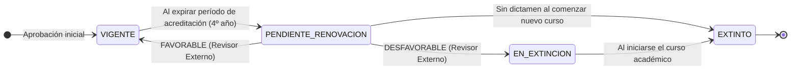
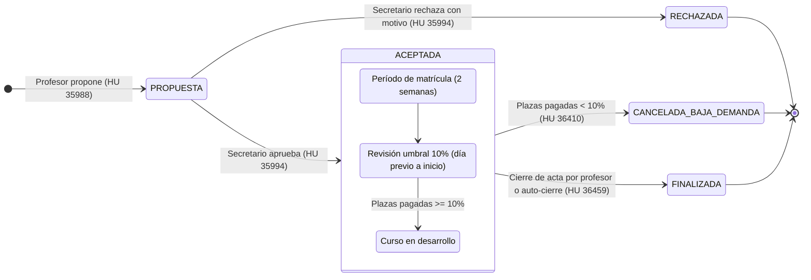
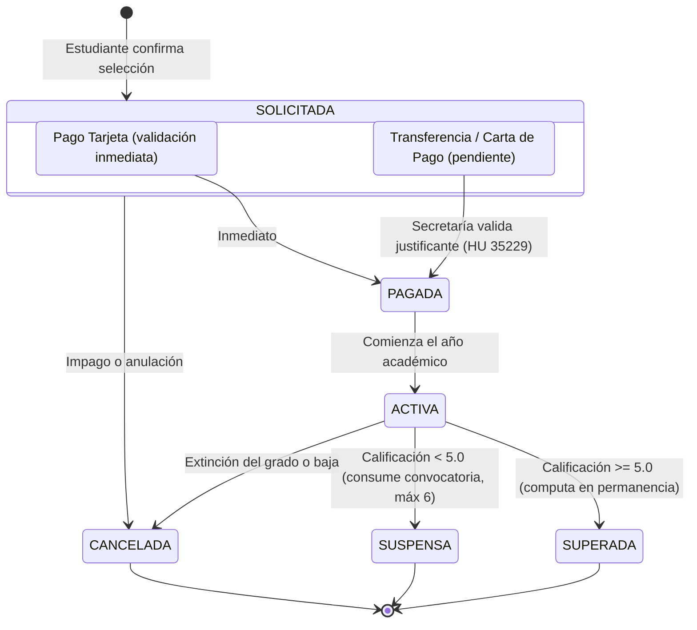
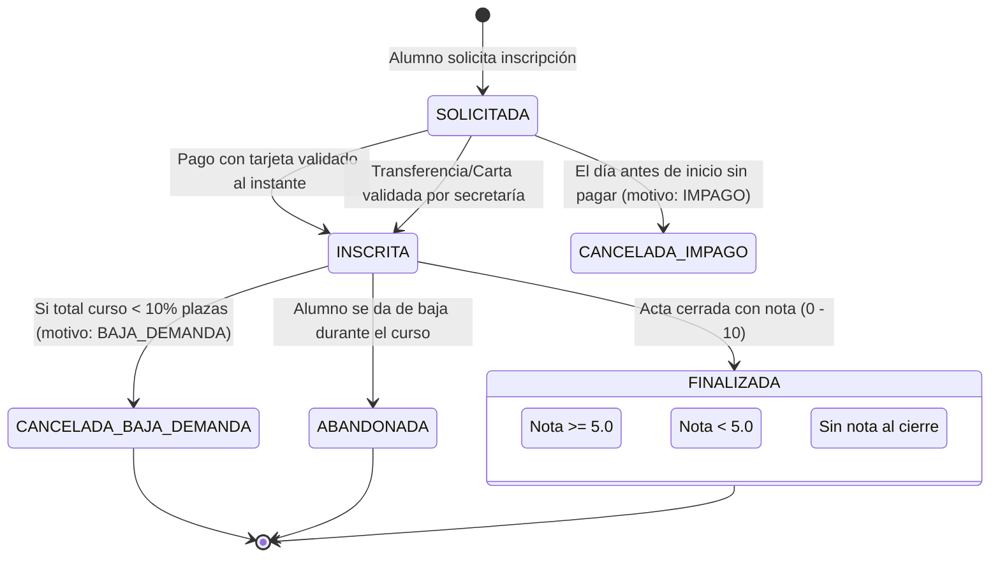

# 1. Ciclo de Vida de la Oferta Académica

## 1.1 Estado de un Grado Universitario

- **VIGENTE:** Ofertado para nuevas matrículas.
- **PENDIENTE_RENOVACION:** Sigue ofertado mientras se audita la calidad académica (HU 36411).
- **EN_EXTINCION / EXTINTO:** No admite nuevos alumnos; se cancelan las matrículas del nuevo año con motivo `EXTINCION_GRADO`.

---

## 1.2 Ciclo de Vida de una Microcredencial

- **PROPUESTA:** Creada por el profesor indicando rama, plazas, créditos y calendario.
- **RECHAZADA:** Descartada por secretaría guardando el motivo de rechazo; no se puede reabrir.
- **ACEPTADA:** Se abre la matrícula pública para estudiantes de la misma rama.
- **CANCELADA_BAJA_DEMANDA:** Proceso batch al cierre de matrícula si $\text{pagadas} \times 10 < \text{plazas}$. Notificación automática en vistas de profesor y alumnos.
- **FINALIZADA:** Acta cerrada por el docente (o auto-cierre a los 15 días tras concluir).

---

# 2. Diagramas de Estados de la Matrícula del Estudiante

## 2.1 Matrícula de Asignaturas de Grado (HU 35235)

---

## 2.2 Inscripción en Microcredencial (HU 35987 & HU 36410)

