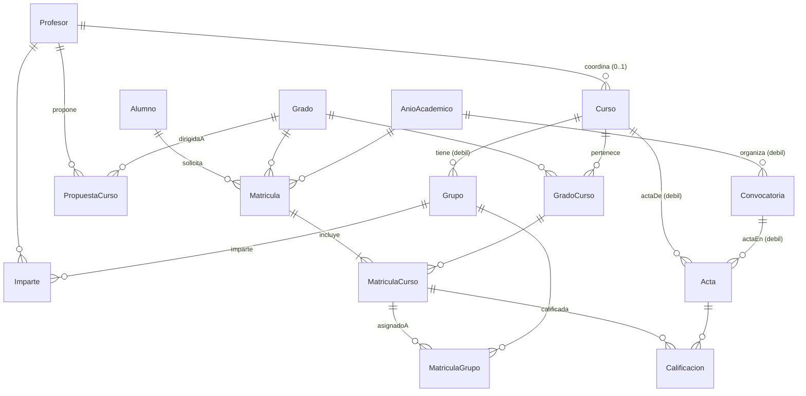
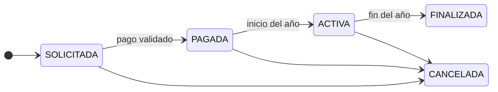

# Base de datos IPS — Cómo funciona

Documentación del modelo de datos tal y como está en `schema.sql` y `data.sql` (versión del 9 de octubre de 2026). Recoge las decisiones tomadas con el PO durante el refinamiento.

## Índice

1. [Visión general](#1-visión-general)
2. [Diagrama](#2-diagrama)
3. [Convenciones](#3-convenciones)
4. [Tablas](#4-tablas)
5. [Ciclos de vida y estados](#5-ciclos-de-vida-y-estados)
6. [Reglas de negocio](#6-reglas-de-negocio)
7. [Qué garantiza la base de datos y qué el modelo](#7-qué-garantiza-la-base-de-datos-y-qué-el-modelo)
8. [Consultas de referencia por historia de usuario](#8-consultas-de-referencia-por-historia-de-usuario)
9. [Datos de prueba](#9-datos-de-prueba)
10. [Cómo se ejecuta](#10-cómo-se-ejecuta)
11. [Limitaciones conocidas y trabajo futuro](#11-limitaciones-conocidas-y-trabajo-futuro)

---

## 1. Visión general

La base de datos gestiona la oferta académica de una universidad y la vida académica de sus alumnos. Tiene 15 tablas, que se agrupan en cuatro bloques:

| Bloque | Tablas | Qué representa |
|---|---|---|
| **Personas** | Alumno, Profesor | Quién usa el sistema. Administrador y Secretario no tienen tabla: son roles que se eligen al lanzar la aplicación. |
| **Oferta académica** | AnioAcademico, Grado, Curso, GradoCurso, PropuestaCurso | Qué se oferta, cuándo y en qué grados. |
| **Docencia y evaluación** | Grupo, Imparte, Convocatoria, Acta | Cómo se organiza la docencia y dónde se ponen las notas. |
| **Matriculación** | Matricula, MatriculaCurso, MatriculaGrupo, Calificacion | En qué se matricula cada alumno, qué ha pagado, a qué grupos va y qué notas tiene. |

**Vocabulario**

- **Curso** significa siempre **asignatura**. El año del grado (1º, 2º…) es el campo `GradoCurso.anio`.
- **Matrícula** es el conjunto de asignaturas de un alumno en un grado durante un año académico. Es "el todo".
- **Matrícula en una asignatura** (MatriculaCurso) es cada una de las partes de ese todo. Tiene su propio estado y su propio pago.
- **Doble grado** es un Grado más, con sus propias asignaturas asociadas, que puede compartir con otros grados.

---

## 2. Diagrama



**Elementos del modelo entidad-relación**

| Elemento | Tipo | Cómo se implementa |
|---|---|---|
| Grupo | Entidad débil de Curso | Clave `(cursoId, grupoCodigo)`. `grupoCodigo` es el discriminante. |
| Convocatoria | Entidad débil de AnioAcademico | Clave `(anioAcademicoId, tipoConvocatoria)`. `tipoConvocatoria` es el discriminante. |
| Acta | Entidad débil con dos propietarias (Curso y Convocatoria) | Clave `(cursoId, anioAcademicoId, tipoConvocatoria)`. No tiene discriminante. |
| [Matricula – incluye – Curso] | Agregación | Tabla MatriculaCurso. Participa a su vez en *asignadoA* (con Grupo) y *calificada* (con Acta). |
| GradoCurso | Relación N:M con atributos | Una asignatura puede estar en varios grados, con distinto año, itinerario y estado en cada uno. |
| Imparte | Relación N:M | Profesor – Grupo. |
| coordina | Relación 1:N | Columna `Curso.coordinadorId`. |

---

## 3. Convenciones

- **Motor:** SQLite.
- **Nombres:** tablas en PascalCase y columnas en camelCase, sin subrayados. Es el convenio de Java que exige DbUtils para mapear columnas a los atributos de los DTO.
- **Restricciones:** todas tienen nombre, con prefijo `pk_`, `fk_`, `uq_` o `ck_`. Estos nombres sí llevan subrayado porque no se mapean a Java.
- **Claves primarias:** son texto con prefijo legible (`AL001`, `G001`, `M001`…). En entidades débiles y relaciones, la clave es compuesta.
- **Fechas:** texto en formato ISO, `'AAAA-MM-DD'`. Se comparan correctamente como texto.
- **Booleanos:** `INT` con valor 0 o 1, controlado con `CHECK`.
- **Valores enumerados** (estados, tipos, motivos): texto en MAYÚSCULAS, controlado con `CHECK ... IN (...)`.
- **Datos sin acentos**, para evitar problemas de codificación al leer los scripts desde Java en Windows.
- **Claves foráneas:** SQLite solo las comprueba si cada conexión ejecuta `PRAGMA foreign_keys = ON`. Sin esa instrucción, las restricciones `fk_` no se aplican.

---

## 4. Tablas

En cada tabla, **PK** indica clave primaria, **FK** clave foránea y **Nulo** si la columna admite valores nulos.

### 4.1 Personas

#### Alumno

| Columna | Tipo | Nulo | Descripción |
|---|---|---|---|
| alumnoId | VARCHAR(10) | no | **PK**. Por ejemplo, `AL001`. |
| dni | VARCHAR(9) | no | Único. |
| nombre | VARCHAR(50) | no | |
| apellidos | VARCHAR(100) | no | |
| email | VARCHAR(100) | no | Único. |

#### Profesor

Misma estructura que Alumno, con clave `profesorId` (por ejemplo, `P001`).

Un profesor puede tener dos roles respecto a una asignatura, y **ninguno se guarda como columna**: es **COORDINADOR** si es el `coordinadorId` de la asignatura, y **DOCENTE** si imparte algún grupo sin ser coordinador.

### 4.2 Oferta académica

#### AnioAcademico

Lo configura el administrador (HU 35220).

| Columna | Tipo | Nulo | Descripción |
|---|---|---|---|
| anioAcademicoId | VARCHAR(10) | no | **PK**. Por ejemplo, `2026-2027`. Al ordenarse como texto, también queda en orden cronológico. |
| fechaInicio | DATE | no | Inicio del año académico. |
| fechaFin | DATE | no | Fin del año académico. Tiene que ser posterior a `fechaInicio`. |
| inicioMatriculacion | DATE | sí | Inicio del periodo de matriculación. |
| finMatriculacion | DATE | sí | Fin del periodo de matriculación. No puede ser anterior al inicio. |

#### Grado

| Columna | Tipo | Nulo | Descripción |
|---|---|---|---|
| gradoId | VARCHAR(10) | no | **PK**. |
| nombre | VARCHAR(150) | no | |
| facultad | VARCHAR(150) | no | Filtro de la HU 35220. |
| ramaConocimiento | VARCHAR(100) | no | Filtro de la HU 35220. |
| estado | VARCHAR(25) | no | `VIGENTE`, `EN_EXTINCION`, `EXTINTO` o `PENDIENTE_RENOVACION`. |
| fechaInicioVigencia | DATE | no | La fecha de fin de vigencia **no se guarda**: se calcula como esta fecha + 4 años. |

#### Curso (asignatura)

Solo guarda lo que es propio de la asignatura, sea cual sea el grado.

| Columna | Tipo | Nulo | Descripción |
|---|---|---|---|
| cursoId | VARCHAR(10) | no | **PK**. |
| coordinadorId | VARCHAR(10) | sí | **FK** → Profesor. Es nulo si todavía no tiene coordinador. |
| nombre | VARCHAR(150) | no | |
| creditos | DECIMAL(4,1) | no | Mayor que 0. Admite medios créditos, como 4.5. |

#### GradoCurso

La relación *pertenece*, de tipo N:M: una asignatura puede formar parte de varios grados. Es el caso de los dobles grados y de asignaturas comunes como Fundamentos de Informática.

| Columna | Tipo | Nulo | Descripción |
|---|---|---|---|
| gradoId | VARCHAR(10) | no | **PK**, **FK** → Grado. |
| cursoId | VARCHAR(10) | no | **PK**, **FK** → Curso. |
| anio | INT | no | Año del grado en el que se imparte (1 a 6). |
| itinerario | VARCHAR(100) | sí | Nulo si es una asignatura común. |
| estado | VARCHAR(10) | no | `ACTIVO` o `INACTIVO`. |

**Por qué el estado está aquí y no en Curso:** si una asignatura está en dos grados y uno de ellos se extingue, tiene que quedar inactiva **solo en ese grado**. En los datos de prueba, Cálculo (C006) está INACTIVO en Matemáticas (G003, en extinción) y ACTIVO en Software (G001) y en el doble grado (G006).

El estado se sobrescribe cada año y **no se guarda historial**.

Una asignatura sin ninguna fila en GradoCurso existe, pero no está asociada a ningún grado todavía (C012 en los datos de prueba).

#### PropuestaCurso

La crea un profesor (HU 35243). De momento solo se registra: revisarla y convertirla en asignatura queda para un sprint futuro.

| Columna | Tipo | Nulo | Descripción |
|---|---|---|---|
| propuestaId | VARCHAR(10) | no | **PK**. |
| profesorId | VARCHAR(10) | no | **FK** → Profesor. |
| gradoId | VARCHAR(10) | no | **FK** → Grado. Es el grado al que se dirige la propuesta. |
| nombre | VARCHAR(150) | no | |
| anio | INT | no | Año del grado propuesto (1 a 6). |
| creditos | DECIMAL(4,1) | no | Mayor que 0. |
| descripcion | VARCHAR(1000) | sí | |
| fechaPropuesta | DATE | no | |
| estado | VARCHAR(10) | no | `PENDIENTE`, `ACEPTADA` o `RECHAZADA`. |

### 4.3 Docencia y evaluación

#### Grupo (entidad débil de Curso)

El grupo es de la **asignatura**, no del grado: alumnos de distintos grados comparten grupo.

| Columna | Tipo | Nulo | Descripción |
|---|---|---|---|
| cursoId | VARCHAR(10) | no | **PK**, **FK** → Curso. |
| grupoCodigo | VARCHAR(10) | no | **PK**, discriminante. Por ejemplo, `PL1`. Solo es único dentro de su asignatura. |
| tipo | VARCHAR(3) | no | `TE` (teoría), `PA` (prácticas de aula) o `PL` (prácticas de laboratorio). |
| capacidad | INT | no | Número máximo de alumnos. Mayor que 0. |

Además de la clave primaria, la tabla tiene un `UNIQUE (cursoId, grupoCodigo, tipo)`. Es redundante, pero hace falta para que MatriculaGrupo pueda apuntar también al tipo con una clave foránea.

#### Imparte (Profesor ↔ Grupo)

| Columna | Tipo | Nulo | Descripción |
|---|---|---|---|
| profesorId | VARCHAR(10) | no | **PK**, **FK** → Profesor. |
| cursoId | VARCHAR(10) | no | **PK**, parte de la **FK** → Grupo. |
| grupoCodigo | VARCHAR(10) | no | **PK**, parte de la **FK** → Grupo. |

#### Convocatoria (entidad débil de AnioAcademico)

| Columna | Tipo | Nulo | Descripción |
|---|---|---|---|
| anioAcademicoId | VARCHAR(10) | no | **PK**, **FK** → AnioAcademico. |
| tipoConvocatoria | VARCHAR(30) | no | **PK**, discriminante. Puede ser `ORDINARIA_ENERO`, `ORDINARIA_JUNIO` o `EXTRAORDINARIA_JULIO`. |
| fechaInicio | DATE | no | |
| fechaFin | DATE | no | No puede ser anterior al inicio. Si al llegar esta fecha el acta sigue abierta, el sistema la cierra automáticamente. |

#### Acta (entidad débil de Curso y Convocatoria)

Es "esta asignatura en esta convocatoria". Hay como mucho un acta por asignatura y convocatoria.

| Columna | Tipo | Nulo | Descripción |
|---|---|---|---|
| cursoId | VARCHAR(10) | no | **PK**, **FK** → Curso. |
| anioAcademicoId | VARCHAR(10) | no | **PK**, parte de la **FK** → Convocatoria. |
| tipoConvocatoria | VARCHAR(30) | no | **PK**, parte de la **FK** → Convocatoria. |
| estado | VARCHAR(7) | no | `ABIERTA` o `CERRADA`. |
| fechaCierre | DATE | sí | Obligatoria si el acta está CERRADA y nula si está ABIERTA. |
| cierreAutomatico | INT | no | 0 si la cerró el coordinador, 1 si la cerró el sistema. Las actas con 1 son la "notificación a secretaría" de la HU 35239. |

### 4.4 Matriculación

#### Matricula (el todo)

Representa a un alumno en un grado durante un año académico. Es lo que cuenta como "año en el grado" para el régimen de permanencia.

| Columna | Tipo | Nulo | Descripción |
|---|---|---|---|
| matriculaId | VARCHAR(10) | no | **PK**. |
| alumnoId | VARCHAR(10) | no | **FK** → Alumno. |
| gradoId | VARCHAR(10) | no | **FK** → Grado. |
| anioAcademicoId | VARCHAR(10) | no | **FK** → AnioAcademico. |
| fechaSolicitud | DATE | no | |
| estado | VARCHAR(10) | no | `SOLICITADA`, `ACTIVA`, `FINALIZADA` o `CANCELADA`. No existe `PAGADA` a este nivel, porque el pago es de cada asignatura. |
| motivoCancelacion | VARCHAR(20) | sí | `IMPAGO`, `FUERZA_MAYOR` o `INCOMPATIBILIDAD`. Obligatorio si y solo si la matrícula está CANCELADA. |
| fechaCancelacion | DATE | sí | Obligatoria si y solo si la matrícula está CANCELADA. |

Restricciones especiales:
- `UNIQUE (alumnoId, gradoId, anioAcademicoId)`: impide solicitudes duplicadas (HU 35235).
- `UNIQUE (matriculaId, gradoId)`: es redundante, pero sirve de destino para la clave foránea de MatriculaCurso.

#### MatriculaCurso (agregación [Matricula – incluye – Curso])

Cada asignatura de una matrícula, con su propio ciclo de vida y su propio pago. **Nunca se borra**: una baja se registra como cancelación.

| Columna | Tipo | Nulo | Descripción |
|---|---|---|---|
| matriculaId | VARCHAR(10) | no | **PK**, parte de la **FK** → Matricula. |
| gradoId | VARCHAR(10) | no | Copia del grado de la matrícula. Forma parte de dos claves foráneas (ver más abajo). |
| cursoId | VARCHAR(10) | no | **PK**, parte de la **FK** → GradoCurso. |
| estado | VARCHAR(10) | no | `SOLICITADA`, `PAGADA`, `ACTIVA`, `FINALIZADA` o `CANCELADA`. |
| motivoCancelacion | VARCHAR(20) | sí | Mismos valores y regla que en Matricula. |
| fechaCancelacion | DATE | sí | Misma regla que en Matricula. |
| importe | DECIMAL(10,2) | no | Créditos × precio por crédito, calculado al solicitar. Se guarda para que un cambio de precio futuro no altere lo ya cobrado. |
| metodoPago | VARCHAR(15) | sí | `TARJETA`, `TRANSFERENCIA` o `CARTA_PAGO`. Es nulo mientras el alumno no ha pagado. |
| fechaPago | DATE | sí | |
| pagoValidado | INT | no | 1 si el pago está aceptado. Con tarjeta es automático; con transferencia o carta de pago lo valida el secretario. |

**El truco del `gradoId` repetido:** la tabla tiene dos claves foráneas que comparten esa columna:
- `(matriculaId, gradoId)` → Matricula: el `gradoId` tiene que ser el de la matrícula.
- `(gradoId, cursoId)` → GradoCurso: la asignatura tiene que pertenecer a ese grado.

Juntas garantizan, **desde la propia base de datos**, que nadie se matricule en una asignatura que no es de su grado.

**Regla de pago (`ck_matriculaCurso_pagada`):** una asignatura PAGADA, ACTIVA o FINALIZADA tiene que tener método de pago, fecha de pago y `pagoValidado = 1`. Una asignatura CANCELADA puede tener pago o no, porque no se devuelve el dinero.

#### MatriculaGrupo (relación *asignadoA* de la agregación)

Los grupos de cada alumno en cada asignatura. Los asigna el secretario.

| Columna | Tipo | Nulo | Descripción |
|---|---|---|---|
| matriculaId | VARCHAR(10) | no | **PK**, parte de la **FK** → MatriculaCurso. |
| cursoId | VARCHAR(10) | no | **PK**, compartido por las dos claves foráneas. |
| tipo | VARCHAR(3) | no | **PK**, parte de la **FK** → Grupo. |
| grupoCodigo | VARCHAR(10) | no | Parte de la **FK** → Grupo. |

Lo que garantiza la propia base de datos:
- La clave primaria `(matriculaId, cursoId, tipo)` impide tener **dos grupos del mismo tipo** en la misma asignatura.
- La clave foránea `(cursoId, grupoCodigo, tipo)` → Grupo obliga a que el grupo sea **de esa asignatura** y **del tipo indicado**.

#### Calificacion (relación *calificada* de la agregación)

Una nota por cada asignatura matriculada y cada convocatoria.

| Columna | Tipo | Nulo | Descripción |
|---|---|---|---|
| matriculaId | VARCHAR(10) | no | **PK**, parte de la **FK** → MatriculaCurso. |
| cursoId | VARCHAR(10) | no | **PK**, compartido por las dos claves foráneas. |
| anioAcademicoId | VARCHAR(10) | no | **PK**, parte de la **FK** → Acta. |
| tipoConvocatoria | VARCHAR(30) | no | **PK**, parte de la **FK** → Acta. |
| nota | DECIMAL(4,2) | sí | Entre 0 y 10. Un valor **nulo significa no presentado**. |

Como `cursoId` es compartido, el acta tiene que ser de la misma asignatura que la matrícula.

---

## 5. Ciclos de vida y estados

### 5.1 Matrícula y sus asignaturas

El estado existe en los dos niveles. **Siempre se cambian juntos**, en el mismo método del modelo:

| Evento | Matricula | MatriculaCurso |
|---|---|---|
| El alumno solicita | SOLICITADA | SOLICITADA (todas) |
| El alumno paga con tarjeta | sin cambios | esa asignatura pasa a PAGADA (`pagoValidado = 1`) |
| El alumno paga por transferencia o carta de pago | sin cambios | sigue SOLICITADA, con método y fecha rellenos y `pagoValidado = 0` |
| El secretario valida el pago | sin cambios | pasa a PAGADA (`pagoValidado = 1`) |
| Empieza el año académico | pasa a ACTIVA si tiene al menos una asignatura PAGADA | las PAGADAS pasan a ACTIVA; las SOLICITADAS quedan pendientes de que las revise el secretario |
| Se cancela una asignatura | sin cambios | esa pasa a CANCELADA, con motivo y fecha |
| Se cancela la última asignatura no cancelada | pasa a CANCELADA, con el motivo y la fecha de esa asignatura | esa pasa a CANCELADA |
| Se cancela la matrícula entera | CANCELADA | todas las no finalizadas pasan a CANCELADA, con el mismo motivo y fecha |
| Termina el año | FINALIZADA | las ACTIVAS pasan a FINALIZADA |


*Estados de MatriculaCurso. Matricula sigue el mismo esquema, pero sin PAGADA.*

Además:
- **Se puede cancelar en cualquier momento** antes de FINALIZADA, y **no se devuelve el dinero**.
- **Nada se borra:** las matrículas y asignaturas canceladas se conservan, junto con sus notas.
- **Plazo de pago:** de momento no existe. Las asignaturas sin pagar se quedan SOLICITADAS hasta que el secretario decide.

### 5.2 Grado

`VIGENTE` → `PENDIENTE_RENOVACION` → `EN_EXTINCION` → `EXTINTO`

"Eliminar" un grado (HU 35223) no lo borra: lo pasa a EN_EXTINCION.

### 5.3 Asignatura en un grado (GradoCurso)

`ACTIVO` ↔ `INACTIVO`

- "Eliminar" una asignatura la pasa a INACTIVO.
- **Desactivación automática al iniciar el año:** se desactiva si su grado está EN_EXTINCION o EXTINTO, o si no tiene matrículas ese año. Ver la consulta en el [apartado 8](#hu-35223--desactivación-automática-al-iniciar-el-año).
- Puede volver a activarse a mano, sin historial.

### 5.4 Acta

`ABIERTA` → `CERRADA`

- La cierra el coordinador (`cierreAutomatico = 0`), o el sistema al pasar la `fechaFin` de la convocatoria (`cierreAutomatico = 1`).
- Mientras está CERRADA no se pueden añadir ni modificar notas.

### 5.5 Propuesta de curso

`PENDIENTE` → `ACEPTADA` o `RECHAZADA`. De momento solo se usa el estado PENDIENTE.

---

## 6. Reglas de negocio

### 6.1 Constantes (en el código, no en la base de datos)

| Constante | Valor | Uso |
|---|---|---|
| `PRECIO_CREDITO` | 20 € | `importe = creditos × 20`. Es igual en todos los grados y no cambia por repetir asignatura. |
| `CREDITOS_MINIMOS_ANIO` | 12 | Créditos superados exigidos cada año. |
| `CREDITOS_MINIMOS_TERCER_ANIO` | 90 | Créditos superados exigidos al acabar el tercer año en el grado. |
| `MAX_CONVOCATORIAS` | 6 | Convocatorias con nota permitidas por asignatura. |
| `NOTA_APROBADO` | 5 | Nota mínima para superar una asignatura. |

### 6.2 Créditos superados

Una asignatura está superada cuando tiene alguna calificación con `nota >= 5`. Sus créditos se suman **una sola vez**, aunque tenga varias notas aprobadas.

### 6.3 Régimen de permanencia (HU 35235)

Al solicitar matrícula en un grado se comprueba:

1. **Mínimo anual:** si la matrícula del año anterior en ese grado **no** está CANCELADA, el alumno tuvo que superar al menos 12 créditos ese año.
2. **Mínimo al tercer año:** si ya lleva 3 o más años en el grado, tiene que sumar al menos 90 créditos superados en total. Los años con la matrícula cancelada **sí cuentan** como años.
3. **Límite de convocatorias:** en cada asignatura solicitada, el alumno tiene que tener menos de 6 convocatorias con nota. Las notas nulas (no presentado) no cuentan. Se suman las de **todos sus años y todos sus grados**.

Si falla la 1 o la 2, se rechaza la matrícula en ese grado, aunque el alumno puede matricularse en otro. Si falla la 3, solo se rechaza esa asignatura.

### 6.4 Al corriente de pago (HU 35235)

**Interpretación actual, pendiente de confirmar con el PO:** el alumno está al corriente si no tiene asignaturas SOLICITADAS sin pagar en años ya iniciados, ni asignaturas canceladas por IMPAGO.

### 6.5 Hitos de permanencia (HU 35232)

Los hitos que ve el alumno son los dos mínimos de la permanencia:
- créditos superados este año, frente a 12;
- créditos superados en total, frente a 90.

### 6.6 Número de matrícula (HU 35232)

**No se guarda.** Para una asignatura en un año, es el número de veces que el alumno se ha matriculado en ella hasta ese año, incluido. La HU lo usa solo para ordenar; no condiciona ninguna regla.

### 6.7 Grupos y plazas

- El alumno tiene **un grupo de cada tipo que tenga la asignatura**.
- Los asigna el **secretario**, después de la matrícula y solo a asignaturas PAGADAS o ACTIVAS.
- No se puede superar `Grupo.capacidad`. Solo ocupan plaza las asignaturas PAGADAS o ACTIVAS del año en curso.

---

## 7. Qué garantiza la base de datos y qué el modelo

### Lo garantiza la base de datos (restricciones)

| Regla | Restricción |
|---|---|
| No hay matrículas duplicadas (alumno + grado + año) | `uq_matricula_solicitud` |
| La asignatura pertenece al grado de la matrícula | `fk_matriculaCurso_matricula` y `fk_matriculaCurso_gradoCurso` |
| Un solo grupo de cada tipo por asignatura | `pk_matriculaGrupo` |
| El grupo es de esa asignatura y de ese tipo | `fk_matriculaGrupo_grupo` |
| El acta es de la misma asignatura que la matrícula | `fk_calificacion_acta` (comparte `cursoId`) |
| Una cancelación tiene siempre motivo y fecha | `ck_*_cancelacionMotivo` y `ck_*_cancelacionFecha` |
| Una asignatura pagada, activa o finalizada tiene el pago validado | `ck_matriculaCurso_pagada` |
| Un acta cerrada tiene fecha de cierre | `ck_acta_cierre` |
| Valores válidos en estados, tipos, motivos y métodos de pago | `ck_*_estado`, `ck_*_tipo`, etc. |
| Rangos numéricos (créditos > 0, nota entre 0 y 10, capacidad > 0…) | `ck_*` |

### Lo tiene que garantizar el modelo (validaciones en Java)

- Las transiciones de estado válidas, y que Matricula y MatriculaCurso cambien siempre juntas.
- La cancelación en cascada (matrícula → asignaturas) y la inversa (última asignatura → matrícula).
- La permanencia, el límite de convocatorias y estar al corriente de pago.
- No superar la capacidad de un grupo.
- Asignar grupos solo a asignaturas PAGADAS o ACTIVAS.
- No matricular en asignaturas INACTIVAS ni en grados EXTINTOS o EN_EXTINCION.
- Solicitar solo dentro del periodo de matriculación.
- Calificar solo en actas ABIERTAS, y que solo el coordinador suba notas y cierre el acta.
- Que un profesor solo proponga asignaturas en grados donde imparte.
- Pedir confirmación antes de "eliminar" un grado o una asignatura, y no hacerlo si deja datos inconsistentes.

---

## 8. Consultas de referencia por historia de usuario

Todas estas consultas están probadas con `data.sql`. Los valores fijos (`'AL001'`, `'2026-2027'`…) son ejemplos; en el código van como parámetros `?`.

### HU 35220 — Vista general del administrador

Asignaturas con sus filtros (grado, año, itinerario, profesor y estado):

```sql
SELECT g.nombre AS grado, gc.anio, gc.itinerario, c.nombre AS curso,
       c.creditos, gc.estado, p.nombre || ' ' || p.apellidos AS coordinador
FROM GradoCurso gc
JOIN Grado g ON g.gradoId = gc.gradoId
JOIN Curso c ON c.cursoId = gc.cursoId
LEFT JOIN Profesor p ON p.profesorId = c.coordinadorId
WHERE gc.gradoId = 'G001' AND gc.estado = 'ACTIVO'
ORDER BY gc.anio, c.nombre;
```

### HU 35223 — Desactivación automática al iniciar el año

```sql
UPDATE GradoCurso
SET estado = 'INACTIVO'
WHERE gradoId IN (SELECT gradoId FROM Grado WHERE estado IN ('EN_EXTINCION', 'EXTINTO'))
   OR NOT EXISTS (SELECT 1 FROM MatriculaCurso mc
                  JOIN Matricula m ON m.matriculaId = mc.matriculaId
                  WHERE mc.gradoId = GradoCurso.gradoId
                    AND mc.cursoId = GradoCurso.cursoId
                    AND m.anioAcademicoId = '2026-2027');
```

### HU 35226 — Matrículas por grupo (secretario)

```sql
SELECT a.alumnoId, a.nombre, a.apellidos, m.gradoId, mc.estado
FROM MatriculaGrupo mg
JOIN MatriculaCurso mc ON mc.matriculaId = mg.matriculaId AND mc.cursoId = mg.cursoId
JOIN Matricula m ON m.matriculaId = mc.matriculaId
JOIN Alumno a ON a.alumnoId = m.alumnoId
WHERE mg.cursoId = 'C005' AND mg.grupoCodigo = 'TE1'
  AND m.anioAcademicoId = '2026-2027';
```

### HU 35229 — Pagos pendientes de validar (secretario)

```sql
SELECT mc.matriculaId, m.alumnoId, mc.cursoId, mc.metodoPago, mc.fechaPago, mc.importe
FROM MatriculaCurso mc
JOIN Matricula m ON m.matriculaId = mc.matriculaId
WHERE mc.estado = 'SOLICITADA'
  AND mc.metodoPago IN ('TRANSFERENCIA', 'CARTA_PAGO')
  AND mc.pagoValidado = 0;
```

### HU 35229 — Asignaturas sin pagar con el año ya iniciado

```sql
SELECT mc.matriculaId, m.alumnoId, mc.cursoId
FROM MatriculaCurso mc
JOIN Matricula m ON m.matriculaId = mc.matriculaId
JOIN AnioAcademico a ON a.anioAcademicoId = m.anioAcademicoId
WHERE mc.estado = 'SOLICITADA' AND mc.metodoPago IS NULL
  AND a.fechaInicio <= '2026-10-09';   -- fecha actual
```

### HU 35229 — Asignaturas a las que les faltan grupos

```sql
SELECT mc.matriculaId, mc.cursoId, mc.estado
FROM MatriculaCurso mc
WHERE mc.estado IN ('PAGADA', 'ACTIVA')
  AND (SELECT COUNT(*) FROM MatriculaGrupo mg
       WHERE mg.matriculaId = mc.matriculaId AND mg.cursoId = mc.cursoId)
    < (SELECT COUNT(DISTINCT tipo) FROM Grupo g WHERE g.cursoId = mc.cursoId);
```

### HU 35229 — Plazas libres por grupo

```sql
SELECT g.cursoId, g.grupoCodigo, g.tipo, g.capacidad,
       g.capacidad - (SELECT COUNT(*)
                      FROM MatriculaGrupo mg
                      JOIN MatriculaCurso mc ON mc.matriculaId = mg.matriculaId AND mc.cursoId = mg.cursoId
                      JOIN Matricula m ON m.matriculaId = mc.matriculaId
                      WHERE mg.cursoId = g.cursoId AND mg.grupoCodigo = g.grupoCodigo
                        AND mc.estado IN ('PAGADA', 'ACTIVA')
                        AND m.anioAcademicoId = '2026-2027') AS plazasLibres
FROM Grupo g
WHERE g.cursoId = 'C005';
```

### HU 35232 — Matriculaciones del alumno en el grado consultado

Al filtrar por `m.gradoId`, en un doble grado solo salen las asignaturas de ese grado. El número de matrícula se calcula en la propia consulta:

```sql
SELECT m.anioAcademicoId, c.nombre, gc.anio, mc.estado,
       (SELECT COUNT(*) FROM MatriculaCurso mc2
        JOIN Matricula m2 ON m2.matriculaId = mc2.matriculaId
        WHERE m2.alumnoId = m.alumnoId AND mc2.cursoId = mc.cursoId
          AND m2.anioAcademicoId <= m.anioAcademicoId) AS numMatricula
FROM MatriculaCurso mc
JOIN Matricula m ON m.matriculaId = mc.matriculaId
JOIN Curso c ON c.cursoId = mc.cursoId
JOIN GradoCurso gc ON gc.gradoId = mc.gradoId AND gc.cursoId = mc.cursoId
WHERE m.alumnoId = 'AL002' AND m.gradoId = 'G002'
ORDER BY gc.anio, numMatricula DESC;
```

### HU 35232 — Créditos superados por año (hitos)

```sql
SELECT m.alumnoId, m.gradoId, m.anioAcademicoId, m.estado,
       COALESCE(SUM(c.creditos), 0) AS creditosSuperados
FROM Matricula m
LEFT JOIN (SELECT DISTINCT matriculaId, cursoId FROM Calificacion WHERE nota >= 5) a
       ON a.matriculaId = m.matriculaId
LEFT JOIN Curso c ON c.cursoId = a.cursoId
WHERE m.alumnoId = 'AL001'
GROUP BY m.matriculaId
ORDER BY m.anioAcademicoId;
```

### HU 35235 — Años en el grado y créditos totales (permanencia)

```sql
SELECT COUNT(*) AS aniosEnGrado,
       COALESCE((SELECT SUM(c.creditos)
                 FROM (SELECT DISTINCT ca.cursoId
                       FROM Calificacion ca
                       JOIN Matricula m2 ON m2.matriculaId = ca.matriculaId
                       WHERE m2.alumnoId = 'AL001' AND m2.gradoId = 'G001'
                         AND ca.nota >= 5) s
                 JOIN Curso c ON c.cursoId = s.cursoId), 0) AS creditosTotales
FROM Matricula
WHERE alumnoId = 'AL001' AND gradoId = 'G001';
```

### HU 35235 — Convocatorias consumidas en una asignatura

```sql
SELECT COUNT(*) AS convocatoriasConsumidas
FROM Calificacion ca
JOIN Matricula m ON m.matriculaId = ca.matriculaId
WHERE m.alumnoId = 'AL002' AND ca.cursoId = 'C005'
  AND ca.nota IS NOT NULL;
```

### HU 35239 — Asignaciones docentes de un profesor, con su rol

```sql
SELECT i.cursoId, c.nombre, i.grupoCodigo, g.tipo,
       CASE WHEN c.coordinadorId = i.profesorId THEN 'COORDINADOR' ELSE 'DOCENTE' END AS rol
FROM Imparte i
JOIN Curso c ON c.cursoId = i.cursoId
JOIN Grupo g ON g.cursoId = i.cursoId AND g.grupoCodigo = i.grupoCodigo
WHERE i.profesorId = 'P003';
```

### HU 35239 — Cierre automático de actas vencidas y aviso a secretaría

```sql
UPDATE Acta
SET estado = 'CERRADA', fechaCierre = '2026-10-09', cierreAutomatico = 1
WHERE estado = 'ABIERTA'
  AND EXISTS (SELECT 1 FROM Convocatoria cv
              WHERE cv.anioAcademicoId = Acta.anioAcademicoId
                AND cv.tipoConvocatoria = Acta.tipoConvocatoria
                AND cv.fechaFin < '2026-10-09');

-- Lo que ve secretaría
SELECT cursoId, anioAcademicoId, tipoConvocatoria, fechaCierre
FROM Acta
WHERE cierreAutomatico = 1;
```

---

## 9. Datos de prueba

`data.sql` sitúa la aplicación en **octubre de 2026**: el año 2025-2026 está cerrado y el 2026-2027 acaba de empezar. Carga 229 registros pensados para probar cada regla.

### Oferta

| Grado | Estado | Para probar |
|---|---|---|
| G001 Software | VIGENTE | El grado principal, con asignaturas de 1º a 4º y un itinerario. |
| G002 Tecnologías de la Información | VIGENTE | Comparte Fundamentos (C005) con G001. |
| G003 Matemáticas | EN_EXTINCION | Todas sus asignaturas están INACTIVAS, aunque Cálculo y Álgebra siguen activas en otros grados. |
| G004 Ciencia de Datos | PENDIENTE_RENOVACION | |
| G005 Química | EXTINTO | No tiene asignaturas. |
| G006 Doble grado Software + Matemáticas | VIGENTE | Comparte C005, C006 y C009 con otros grados. |

También hay una asignatura sin grado ni coordinador (C012) y tres propuestas, una en cada estado.

### Alumnos y escenarios

| Alumno | Escenario |
|---|---|
| AL001 Lucía | Supera 12 créditos en 2025-26 y cumple la permanencia. En 2026-27 se da de baja de una asignatura (C001, por INCOMPATIBILIDAD), que queda registrada como cancelada. |
| AL002 Hugo | Supera 0 créditos en G001, así que **no puede volver a matricularse en G001** y se cambia a G002. Arrastra 2 convocatorias consumidas en Fundamentos (2ª matrícula). En Cálculo tiene un "no presentado", que no cuenta. |
| AL003 Sara | Supera 18 créditos. Tiene una asignatura aprobada en la convocatoria extraordinaria. |
| AL004 Mario | Alumno de G002 que comparte grupos de Fundamentos con alumnos de G001. |
| AL005 Paula | Matrícula de 2025-26 cancelada por IMPAGO: ese año cuenta, pero no se le exigen los 12 créditos. |
| AL006 Daniel | Ha pagado por transferencia y está pendiente de que lo valide el secretario. |
| AL007 Laura | Una asignatura activa con solo el grupo TE asignado (le faltan PA y PL) y otra sin pagar, pendiente de revisión del secretario. |
| AL008 Álvaro | Matriculado en un grado PENDIENTE_RENOVACION. |
| AL009 Irene | Matrícula cancelada entera por FUERZA_MAYOR, después de pagar y sin devolución. |
| AL010 Pablo | Matrícula cancelada al cancelar su única asignatura. |
| AL011 Noelia | Ha pagado después de iniciarse el año: asignatura PAGADA, matrícula todavía SOLICITADA y sin grupos. |
| AL012 Iván | Sin ninguna matrícula (perfil vacío). |
| AL013 Marina | Alumna del doble grado; comparte grupos con alumnos de G001 y G002. |

### Actas

- **2025-26:** todas cerradas, y una cerrada automáticamente por el sistema (Cálculo, extraordinaria de julio). Excepto la extraordinaria de julio de Ingeniería del Proceso Software (C001), que se carga ABIERTA aunque su convocatoria ya terminó: es la que cierra el sistema al arrancar la aplicación (HU 35239).
- **2026-27:** abiertas y todavía sin notas.

---

## 10. Cómo se ejecuta

1. Ejecutar `schema.sql`, que borra y vuelve a crear todas las tablas.
2. Ejecutar `data.sql`, que vacía las tablas y carga los datos de prueba. Se puede relanzar sin volver a ejecutar `schema.sql`.

Es el mismo orden que siguen `createDatabase` y `loadDatabase` en el proyecto de ejemplo. Los dos ficheros van en `src/main/resources`.

Para que se apliquen las claves foráneas, cada conexión tiene que ejecutar:

```sql
PRAGMA foreign_keys = ON;
```

---

## 11. Limitaciones conocidas y trabajo futuro

| Tema | Situación actual | Cómo ampliarlo sin romper nada |
|---|---|---|
| **Plazo de pago** | No existe: lo sin pagar queda pendiente del secretario. | Añadir `finPlazoPago` en AnioAcademico y un proceso que cancele por IMPAGO lo que siga sin pagar. |
| **Revisión de propuestas** | Las propuestas solo se registran. | Añadir `cursoId` (la asignatura que se crea al aceptar) y `motivoRechazo` en PropuestaCurso. |
| **Historial de estado de las asignaturas** | El estado ACTIVO/INACTIVO se sobrescribe. | Crear una tabla `Oferta(gradoId, cursoId, anioAcademicoId, estado)`. |
| **Grupos por año** | Un grupo pertenece a la asignatura, no al año, así que se reutiliza cada año (la capacidad se cuenta por año en la consulta). | Añadir `anioAcademicoId` a Grupo si cada año cambian los grupos o sus profesores. |
| **Precio por año** | Constante en el código. | Añadir `precioCredito` en AnioAcademico. |
| **Al corriente de pago** | Interpretación propia (ver 6.4). | Confirmar con el PO. |
